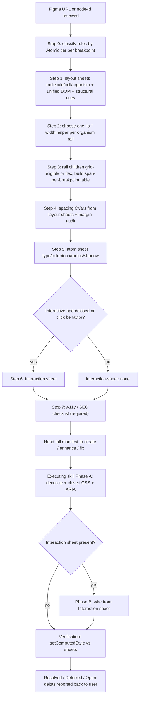

# lledsue-figma-to-code

A read-only translator. Given one or more Figma frames, this skill emits a **translation manifest** (tier inventory, per-tier layout sheets, unified DOM tree, width helper choice, grid-placement table, spacing CVar manifest, atom CVar manifest, when interactive — an Interaction sheet, and a **required** A11y/SEO checklist) and hands the manifest to the executing skill. Extraction follows Atomic 2.0 ownership ([`.cursor/rules/lledsue-atomic-design.mdc`](../../rules/lledsue-atomic-design.mdc) "Figma Atomic Extraction"): atoms own type/color/icon values; molecules / cells / organisms own layout arrangement. Behavior (open/close, drawers, modals) is orthogonal — see "Behavior layer" and Step 6. Step 7 (A11y/SEO) is always required. The order of the steps is mandatory - earlier steps constrain later steps. Most of the regressions we hit in this repo (cap-on-cap width bugs, breakpoint-divergent DOM, doubled vertical gaps, child margins, literal `width: 640px` in block CSS) come from skipping or reordering these steps.

## When to use this skill

Trigger on any of:

- A Figma URL or node-id is pasted in the task description.
- A pinned frame from [.cursor/figma-references.md](../../figma-references.md) is referenced by name (e.g. "PDES Step 1 LG/XL").
- The user asks to "match Figma", "fix the design", "align spacing", "audit deltas", "pixel-perfect", or similar.

Do **not** use this skill for:

- Pure JS / behaviour changes with **no** design implication (no Figma open/closed frames, no visual chrome for the panel). Those go straight to the executing skill's Phase B with a hand-written Interaction sheet.
- New block scaffolding that has no Figma reference yet (go straight to [lledsue-create-block](../lledsue-create-block/SKILL.md) and revisit this skill when Figma lands).
- Token authoring (route to [lledsue-create-token](../lledsue-create-token/SKILL.md) directly).

When design **and** behavior both exist (closed card + open popup, mega-menu open frame, drawer), run Steps 0–5 for static chrome, then **Step 6** for the Interaction sheet, then **Step 7** (always). Pure static surfaces still run Step 7 after Steps 0–5 (Step 6 records `interaction-sheet: none`).

## Required inputs

Ask for anything not provided. Frame-coverage and A11y gates are mandatory — do **not** invent missing breakpoints, component states, or a11y chrome.

### Breakpoint coverage

- Prefer the full SM (≤767) / MD (768-1023) / LG (1024-1439) / XL (≥1440) set (one URL or node-id each).
- If only one frame is provided, ask which breakpoint it represents and whether the others exist.
- If any breakpoint is missing, **ask** (do not invent layout): does a frame exist? If not, may we derive from the nearest provided band? Record the answer in the manifest (`md-frame: none — user approved derive from LG`).

### State coverage (component-dependent)

- After Step 0 (or as soon as interactivity / variants are obvious), enumerate the **state set this component needs**. Do **not** assume “open” is the only extra state — states vary by surface.
- Illustrative (not exhaustive):

  | Surface type | Typical extra states to ask for |
  |---|---|
  | Accordion / disclosure | expanded item (answer visible); optionally single-open vs multi |
  | Mega-menu / flyout | panel open; maybe hover vs click |
  | Drawer / sheet | open; optionally nested subpanel |
  | Modal / dialog | open (+ close affordance) |
  | Tabs | selected tab panel |
  | Stepper / wizard | step N active |
  | Form / validation | error, success, disabled |
  | Cards / tiles | hover, selected, featured |

- For each needed state missing from the provided frames, **ask** for a Figma node (or confirm “none — proceed with Behavior pick-list / molecule defaults only”). Record per state (`state-frames: expanded=none — user approved defaults`).
- Never invent state-only visual deltas (chevron rotate, panel pad, flyout shadow, scrim) without a frame **or** explicit user approval.

### A11y / SEO coverage (always — Step 7)

- Every manifest **must** include Step 7 (`a11y-seo-checklist`). There is no skip for static surfaces.
- When the surface needs focus / error / disabled (or other a11y-relevant) design states that are not in the provided frames, **ask** (same posture as State coverage). Record answers (`state-frames: focus=none — user approved defaults`). Do not invent focus-ring or error chrome.

### Always required

- **Target block id** - existing block under `blocks/<id>/` or a proposed id for a new block.
- **Atomic 2.0 tier** - `cell` or `organism` per [.cursor/rules/lledsue-atomic-design.mdc](../../rules/lledsue-atomic-design.mdc) (`atom` routes to `lledsue-create-token`; `molecule` reuses existing primitives).
- **Mode** - `create` (new block), `enhance` (additive change), or `fix` (design alignment). Picks the executing skill.

If the user pinned the frames in [.cursor/figma-references.md](../../figma-references.md), accept the section name as input and read URLs from there.

## Workflow

```
- [ ] Step 0: Atomic tier inventory (role × tier × breakpoint)
- [ ] Step 1: Per-tier layout sheets + unified DOM + structural cue matrix
- [ ] Step 2: Width helper selection (organism rail)
- [ ] Step 3: Grid-column compatibility per rail child (organism / cell only)
- [ ] Step 4: Spacing from layout sheets -> --ll-space-N CVar manifest (+ margin audit)
- [ ] Step 5: Atom sheet -> --ll-font-* / --ll-color-* / icon / radius / shadow CVars
- [ ] Step 6: Interaction sheet (when open/closed / drawer / modal / click behavior) — skip for pure static
- [ ] Step 7: A11y / SEO checklist (+ i18n hard rule) — **required always**
- [ ] Hand off the manifest to lledsue-create-block / lledsue-enhance-block / lledsue-fix-block
- [ ] Verification loop: computed-style diff vs. Figma across breakpoints
```

Do not move to step N+1 until step N's output is recorded. The manifest is the contract between this skill and the executing skill.

### Step 0 - Atomic tier inventory

**Goal:** every visible Figma node has a stable **role id**, an Atomic 2.0 **tier**, and a presence flag per breakpoint — before any spacing or type mapping. Ownership rules live in [`.cursor/rules/lledsue-atomic-design.mdc`](../../rules/lledsue-atomic-design.mdc) "Figma Atomic Extraction".

**Preamble - clear the anchor.** If this block already ships, ignore its existing CSS as the reference for this pass. Re-extract from Figma first. Prior-code inertia is the root cause of most multi-round Figma parity misses (see [`.cursor/rules/lledsue-atomic-design.mdc`](../../rules/lledsue-atomic-design.mdc) "Past code is not a source of truth on Figma-driven re-visits").

1. Pull each available frame using the Figma MCP. Prefer `get_metadata` first (frame tree), then `get_design_context` (structure reference only), `get_screenshot`, and later `get_variable_defs` (Step 5).
2. Walk the metadata tree. For every visible node across all frames, assign a stable **role id** (e.g. `step-header`, `pill-row`, `disclaimer`, `optin`, `result-card`). Same role across breakpoints = same DOM element.
3. Classify each role as `atom` | `molecule` | `cell` | `organism` using the Tier mapping in [`.cursor/rules/lledsue-atomic-design.mdc`](../../rules/lledsue-atomic-design.mdc):
   - **Atom** — text style, color, icon size, radius, shadow, border-width (no layout).
   - **Molecule** — primitive composed of atoms (button, title+icon row, input wrap).
   - **Cell** — 2+ molecules (tile, drawer item, form cluster).
   - **Organism** — section composed of cells / molecules (the block rail / section).
4. Nest atoms under their parent molecule / cell in the inventory so ownership is obvious (atoms never appear as orphan layout owners).
5. Emit a **tier inventory** (presence matrix keyed by role × tier × breakpoint):

   | role | tier | parent | SM | MD | LG | XL | notes |
   |------|------|--------|----|----|----|----|-------|
   | pdes (rail) | organism | - | yes | yes | yes | yes | section rail |
   | step-header | molecule | pdes | yes | yes | yes | yes | title + subtitle cluster |
   | scan-title | atom | step-header | yes | yes | yes | yes | typography only |
   | pill-row | molecule | form | yes | yes | yes | yes | flex col SM, flex row MD+ |
   | form--scan | cell | pdes | yes | yes | yes | yes | grid-eligible rail child |

**Output of step 0:** tier inventory table. Nothing else proceeds until every visible role has a tier and parent.

### Step 1 - Per-tier layout sheets + unified DOM + structural cue matrix

**Goal:** one DOM tree that renders correctly at every breakpoint via CSS — plus **layout sheets** for every non-atom role (molecule → cell → organism) and an inventory of every structural cue so nothing lands only in typography.

1. Decide per role (from the Step 0 inventory):

   - **Always present** -> one DOM node; visibility / order / direction varies via CSS.
   - **One breakpoint only** -> still one DOM node, hidden at the others via `@media`. Never duplicate.
   - **Reordered** -> rely on flex ordering (or rail `grid-column` order), not duplicate DOM. Prefer source order = SM order so progressive enhancement is clean.
   - **Different content per breakpoint** (rare) -> document explicitly. If unavoidable, surface as a hand-off note so the executing skill can decide on `<picture>` art-direction or similar pattern.

2. Emit an ASCII unified DOM tree as the working contract (annotate tier on each role):

   ```
   .<block>__root.grid                                <- organism rail: width helper + .grid
   |-- .<block>__step-header                          <- molecule; spans 12 at MD+; spans 4 at SM
   |    |-- h2.<block>__title                         <- atom (type)
   |    +-- p.<block>__subtitle                       <- atom (type)
   +-- .<block>__form                                 <- cell; grid-column: 4 / span 6 at MD+
        |-- .<block>__pill-row                        <- molecule; flex (not grid-eligible)
        |    |-- .<block>__email-wrap                 <- molecule
        |    +-- button.<block>__submit               <- molecule (button primitive)
        +-- .<block>__meta                            <- molecule
             |-- p.<block>__disclaimer                <- atom
             +-- label.<block>__optin                 <- molecule
   ```

3. **Layout sheets.** For every non-atom role, per breakpoint, record layout ownership from `get_metadata`. Emit three sheets into the manifest: `molecule-layout`, `cell-layout`, `organism-layout`.

   | role | tier | bp | display | justify / align | gap (itemSpacing) | padding-block / inline | stroke decision | notes |
   |------|------|----|---------|-----------------|-------------------|------------------------|-----------------|-------|
   | pill-row | molecule | SM | flex col | start / stretch | 8 | 0 / 0 | - | internal flex; not page grid |
   | pill-row | molecule | MD | flex row | start / center | 16 | 0 / 0 | - | |
   | form--scan | cell | LG | flex col | start / stretch | 24 | 0 / 0 | - | rail child; span from Step 3 |
   | pdes | organism | LG | grid (rail) | - | gutter decision | 80 / 0 | - | width helper + section pad |

   Mapping rules (hard):

   - `layoutMode` → CSS `display`. Default **flex** for internal composition. Use CSS `grid` / `.grid` **only** when the role is the page rail or a direct rail child participating in 12-col placement (Step 3).
   - `primaryAxisAlignItems` / `counterAxisAlignItems` → `justify-content` / `align-items`.
   - `itemSpacing` → parent **`gap`**. Never translate sibling spacing into child `margin-*`.
   - Padding → container `padding-block` / `padding-inline` (shorthand when symmetric).
   - Strokes: prefer **`outline`** (or non-layout `box-shadow`) when the stroke must not change box size (focus rings, decorative rings). Use **`border`** only for layout edges and collapsed divider frames (below).
   - Atoms do **not** appear on these sheets — they have no layout properties.

4. **Structural cue matrix.** For every child frame in `get_metadata`, record what it *does* beyond housing content. This is where dividers, backgrounds, and alignment survive the extraction. Fields:

   | role | breakpoint | fills | strokes | border-block-start | border-block-end | background | primaryAxisAlignItems | counterAxisAlignItems | itemSpacing | notes |
   |------|------------|-------|---------|--------------------|------------------|------------|-----------------------|-----------------------|-------------|-------|
   | header | SM | - | - | - | 1px `Color/Border/default` | - | SPACE_BETWEEN | CENTER | - | `HorizontalBorder` sibling collapses into `border-block-end` on `.__header` |
   | header | MD | - | - | - | - | - | START | CENTER | - | no divider MD+ |
   | step | any | - | - | 1px `Color/Border/default` | - | - | START | START | 16 | every list item carries the divider on top |
   | plans-label | any | - | - | 1px `Color/Border/default` | - | - | START | START | - | + `padding-block-start: 32` + `margin-block-start: calc(-1 * --ll-space-8)` to cancel parent flex-gap |
   | plan-pill | any | `Color/Background/muted` | - | - | - | `--ll-color-bg-muted` | START | CENTER | 4 | 38-tall rounded surface |

   Divider detection rules (any of these makes the child frame a divider, not its own DOM node - collapse to a `border-*` on the adjacent semantic element):

   - `name` contains `Border`, `HorizontalBorder`, `Divider`, `Line`, `Separator`, `Rule`, or `Underline`.
   - `height ≤ 2` **and** `fills` is set (horizontal divider).
   - `width ≤ 2` **and** `fills` is set (vertical divider).

   Background detection rule: a child frame with `fills` set and no text children is a background surface. Collapse into a CSS `background` on the adjacent semantic element - do not add an empty `<div>` for it.

   Explicit example: at SM the `product-feature-tile` popup's Figma frame contains a `HorizontalBorder` sibling between the kicker row and the title. It is **not** a `<hr>` in the DOM - it collapses into `border-block-start: 1px solid var(--ll-color-border-default)` on the title element, wrapped in `@media (width < 768px)`. Same collapsing pattern applies to the "How it works" section-label -> step-1 divider (every step carries `border-top`, first step is not zeroed).

   Discipline: only after the layout sheets + structural cue matrix are emitted does the extraction move to spacing (Step 4) and atoms (Step 5). Skipping them is the root cause of "the popup ships without the divider" regressions - see [`.cursor/rules/lledsue-atomic-design.mdc`](../../rules/lledsue-atomic-design.mdc) "Structural cue extraction is mandatory".

5. **Doc-vs-cue diff (existing blocks only).** If this is a re-visit on a block that already ships a `<id>.md`, spot-check the doc's design-lock table against the structural cue matrix and layout sheets. Every contradiction (doc says "first step's border is the divider" but the CSS zeros it, or the doc has no row for a border that Figma requires) becomes a required patch in this pass. This is the earliest point in the workflow where doc-vs-CSS drift is caught cheaply.

**Output of step 1:** unified DOM tree + `molecule-layout` / `cell-layout` / `organism-layout` sheets + structural cue matrix + (for re-visits) a short list of doc-vs-cue contradictions. Nothing else proceeds until these exist.

### Step 2 - Width helper selection

**Goal:** pick **one** `.is-<static|fluid|full>-<width|bleed>` helper per top-level **organism** rail (from the organism-layout sheet). Children must not re-cap.

1. Read the outermost Figma frame's width at each breakpoint and answer:

   - Is content **capped at 1312 with margin rails outside**? -> `.is-static-width`
   - Is content **fluid up to 1440 with gutter outside**? -> `.is-static-bleed`
   - Is content **fluid up to 1312 with gutter inside the rail**? -> `.is-fluid-width`
   - Is content **fluid up to 1440 painting through gutters**? -> `.is-fluid-bleed`
   - Is content **edge-to-edge, no cap**? -> `.is-full-width` (margin rail) or `.is-full-bleed` (paints to viewport edge).
   - Hybrid (e.g. cream-band background spans full bleed, inner content capped): two layers - outer painted element uses `.is-full-bleed`, inner content wrapper uses `.is-static-width` or `.is-fluid-width`.
   - **Ambiguous 1312 + rails:** prefer **`.is-fluid-width`** over `.is-static-width` unless the design is clearly a fixed-cap with margin rails outside. If both could fit, check a shipped sibling organism (e.g. FAQ uses fluid) or ask once. Do not default to static.

2. Cross-check against the exact formulas in [styles/styles.css](../../../styles/styles.css) lines 1287-1373:

   - `.is-static-width` -> `max-width: var(--ll-grid-content)`
   - `.is-static-bleed` -> `max-width: calc(var(--ll-grid-content) + 2 * var(--ll-grid-margin))`
   - `.is-fluid-width` -> `max-width: min(100dvw - 2 * var(--ll-grid-margin), 1312px)`
   - `.is-fluid-bleed` -> `max-width: min(100dvw, 1440px)`
   - `.is-full-width` -> `max-width: calc(100dvw - 2 * var(--ll-grid-margin))`
   - `.is-full-bleed` -> `width: 100dvw` with `margin-inline: calc(50% - 50dvw)`

3. Hard rule: only the rail wrapper carries the helper. Children consume it implicitly. Never apply two width helpers on the same axis - the inner helper silently shadows the outer cap.

**Output of step 2:** one helper class per rail wrapper, with a one-sentence rationale (which Figma observation drove the choice).

### Step 3 - Grid-column compatibility

**Goal:** for each **direct child of the organism rail** (cell or molecule that participates in page placement), decide whether it participates in the 12-column grid and how its span responds across breakpoints. Internal composition stays on flex per the layout sheets — do not invent nested CSS grids for 2-item rows.

The grid utility is defined in [styles/styles.css](../../../styles/styles.css) lines 1412-1469. It already wires a mobile-first cascade through `--grid-col-{sm,md,lg,xl}` CVars and inline `grid-column` declarations.

1. For each rail-child role from the cell/organism layout sheets, classify:

   - **Grid-eligible** - the Figma node is described as a fraction of the 12-column rail (e.g. 6 of 12, 8 of 12, full 12). Implementation: drop into the grid as a direct child of `.grid`.
   - **Flex / block-only** - the Figma node is a fixed control (single pill, single button, fixed-width card) that should hug or stretch inside its grid cell. Implementation: wrap inside a grid-eligible parent and lay out internally with **flex** (from the molecule/cell layout sheet).

2. For each grid-eligible role, build the span-per-breakpoint matrix and identify the start column when there's an offset:

   | role | SM (4-col) | MD (12-col) | LG (12-col) | XL (12-col) |
   |------|------------|-------------|-------------|-------------|
   | step-header | span 4 | span 12 | span 12 | span 12 |
   | form | span 4 | span 8 | `4 / span 6` | `4 / span 6` |
   | result-rail | span 4 | span 10 | span 10 | span 10 |

3. Pick the implementation pattern per role:

   - **Default span** (4 at SM, 12 at MD+) -> rely on `.grid > *` shorthand. Emit no per-element CSS.
   - **Single-axis override** (e.g. span 8 at MD+ across LG/XL) -> set `--grid-col-md: 8` once on the role's class; LG/XL inherit via the cascade in lines 1459-1468.
   - **Different span per breakpoint** -> declare each `--grid-col-{sm,md,lg,xl}` on the role's class. Declare at the smallest band that needs the override.
   - **Span + offset** (e.g. "6 cols centered" = start at col 4) -> use explicit `grid-column: 4 / span 6` declarations under the corresponding media query. The `--grid-col-*` CVars cannot express start-column.
   - **Full rail at all bands** -> `grid-column: 1 / -1` (works across all breakpoints regardless of column count).

4. Anti-rule: **never** translate a Figma fixed pixel width (e.g. `w-640`) into a literal CSS `width: 640px` on a block element. Always go through grid-column. If the Figma fixed-width happens to equal `span 6` at the current breakpoint's content width, that's fine - use the grid expression. If it diverges across breakpoints, the grid expression is still the right answer because it carries the responsive intent.

**Output of step 3:** span-per-breakpoint table + the exact `grid-column` / `--grid-col-*` CSS lines that will be emitted.

### Step 4 - Spacing (padding / gap) from layout sheets

**Goal:** every spacing value on the molecule / cell / organism layout sheets maps to a `--ll-space-N` token. Every spacing decision becomes a CVar; breakpoint variations become media-query CVar overrides. The CSS rule body itself never re-declares values - it always reads CVars. **Do not re-read Figma ad hoc** — drive this step from the Step 1 sheets.

**Dual-source confirmation.** For each spacing property, classify Figma's source before pairing (see [`.cursor/rules/lledsue-atomic-design.mdc`](../../rules/lledsue-atomic-design.mdc) "Dual-source confirmation"):

- `figma-source: variable:<name>` — bound Figma variable → resolve via `get_variable_defs` (THEME: LifeLock) → grep-pair `--ll-space-N`.
- `figma-source: primitive:<px>` — raw Auto Layout / metadata px → grep-pair `--ll-space-N` by value. Never ship the raw px in block CSS.

Every row in the spacing CVar manifest MUST carry its `figma-source` tag.

1. For each non-atom role on the layout sheets, emit CVars for:

   - `padding-block-start`, `padding-block-end` (use `padding-block` shorthand when symmetric)
   - `padding-inline-start`, `padding-inline-end` (use `padding-inline` shorthand when symmetric)
   - `gap` (flex / grid containers); for rail `.grid` containers, `row-gap` / `column-gap` separately if they differ
   - **Never** emit child `margin-*` for sibling spacing — that belongs on the parent's `gap` (or the parent's `padding`).

2. **Margin audit (required).** Before writing the CVar manifest, scan the layout sheets and any proposed CSS for `margin-*` on leaves / molecules used to space siblings. Reject those and rewrite as parent `gap` or parent `padding`. The only allowed `margin-*` exceptions (document each in the manifest notes):

   - Canceling a parent flex-gap (`margin-block-start: calc(-1 * var(--ll-space-N))`) — existing section-label pattern.
   - Sticky / absolute overlays that must pull out of normal flow.

3. Map every value through the spacing lookup table (after confirming `figma-source` and resolving the value):

   | CVar | px | Common Figma names | Notes |
   |------|----|-------------------|-------|
   | `--ll-space-0` | 0 | - | true zero only |
   | `--ll-space-1` | 2 | hairline | rare |
   | `--ll-space-2` | 4 | xxs | |
   | `--ll-space-3` | 8 | xs | |
   | `--ll-space-4` | 12 | sm- | |
   | `--ll-space-5` | 16 | sm | grid-gutter SM |
   | `--ll-space-6` | 20 | md- | |
   | `--ll-space-7` | 24 | md | grid-gutter LG |
   | `--ll-space-8` | 32 | lg- | grid-margin MD; grid-gutter XL |
   | `--ll-space-9` | 40 | lg | |
   | `--ll-space-10` | 44 | - | grid-margin LG |
   | `--ll-space-11` | 48 | xl- | |
   | `--ll-space-12` | 56 | - | |
   | `--ll-space-13` | 64 | xl | grid-margin XL |
   | `--ll-space-14` | 72 | - | |
   | `--ll-space-15` | 80 | xxl | typical section pad-block MD+ |
   | `--ll-space-16` | 88 | - | |
   | `--ll-space-17` | 96 | - | |
   | `--ll-space-18` | 104 | - | |

   Source of truth: [styles/styles.css](../../../styles/styles.css) lines 345-385.

   If Figma uses a value not in this table (e.g. 18px, 28px, 36px), do **not** invent a literal. Stop and either (a) round to the nearest token and surface the rounding decision, or (b) route to [lledsue-create-token](../lledsue-create-token/SKILL.md) if the new value is design-system worthy.

4. Emit a CVar manifest. Pattern (CSS for the executing skill; keep `figma-source` tags in the manifest notes / table alongside each CVar):

   ```css
   .<block> {
     /* SM defaults - mobile-first */
     --<block>-section-pad-block: var(--ll-space-9);   /* 40; figma-source: primitive:40 */
     --<block>-step-gap: var(--ll-space-8);            /* 32; figma-source: variable:Spacing/lg */
     --<block>-pill-row-gap: var(--ll-space-3);        /* 8; figma-source: primitive:8 */
   }

   @media (width >= 768px) {
     .<block> {
       --<block>-section-pad-block: var(--ll-space-15); /* 80; figma-source: primitive:80 */
       --<block>-step-gap: var(--ll-space-11);          /* 48; figma-source: variable:Spacing/xl */
       --<block>-pill-row-gap: var(--ll-space-5);       /* 16; figma-source: primitive:16 */
     }
   }
   ```

   Manifest row shape (required alongside the CSS):

   | CVar | bp | px | `--ll-*` | figma-source | grep-confirmed |
   |------|----|----|----------|--------------|----------------|
   | `--<block>-pill-row-gap` | SM | 8 | `--ll-space-3` | `primitive:8` | yes |

   Re-declare only the CVars that change at each breakpoint. Never re-declare the rule body in a media query.

5. Use shorthand properties (`padding-block`, `padding-inline`, `padding`) when start/end values are equal - the project Stylelint config flags long-form variants when shorthand would work. See [.cursor/rules/lledsue-units.mdc](../../rules/lledsue-units.mdc).

6. **Avoid the double-counting trap.** If a container has both `padding-block` and a parent that supplies `row-gap`, the gap and the padding stack. Pick one path (typically the parent's gap) and zero the other. Most of our "too big vertical gap" regressions trace back to this.

7. **Grid gap is never silent.** When a role is rendered as `.grid` (either the global utility in [`styles/styles.css`](../../../styles/styles.css) or a block-scoped grid container), the CVar manifest MUST record a gap decision  it is never allowed to omit the property and inherit the global default. Two valid outcomes:

   - **Global rhythm matches Figma** - state it explicitly with a comment:

     ```css
     .<block>__grid {
       /* matches global rhythm: 12/16/24/32 across SM/MD/LG/XL */
       gap: var(--ll-grid-gutter);
     }
     ```

   - **Design calls for a different rhythm** - override with an explicit `--ll-space-N` per breakpoint:

     ```css
     .<block>__grid {
       gap: var(--ll-space-5);   /* SM: 16 */
     }
     @media (width >= 768px) {
       .<block>__grid {
         gap: var(--ll-space-6);  /* MD+: 20 */
       }
     }
     ```

   Anti-pattern: leaving `gap` unset on a `.grid` consumer. The `.grid` utility defaults `gap: var(--ll-grid-gutter)`, which "works" visually and hides the omission; the resulting rhythm rarely matches the design once anyone measures. The `product-feature-tiles` organism (16/20/20/20) is the canonical case  the global gutter would land it at 12/16/24/32 with two breakpoints wrong. State the decision, always.

**Output of step 4:** a spacing CVar manifest (driven by the layout sheets) with the SM base + breakpoint override media queries, a `figma-source` tag on every row, plus a completed margin audit (zero unexcused child margins). If the block contains any `.grid` consumer, the manifest MUST include an explicit gap declaration for it.

### Step 5 - Atom sheet (typography, color, icons, radius, shadow)

**Goal:** every **atom** role from the Step 0 inventory maps to a semantic token. Zero hex literals, zero raw font stacks, zero px font-sizes in block CSS. Icons resolve by *visible* stroke span, not by nominal canvas dimension. **Atoms do not receive layout properties** (no gap, padding, align-items) — those stay on the molecule / cell / organism sheets from Step 1.

**Dual-source confirmation.** Same gate as Step 4 for every atom property (color, font-size, line-height, letter-spacing, radius, shadow, border-width, icon size). Tag each atom-sheet row:

- `figma-source: variable:<name>` — e.g. `variable:Color/Content/secondary` → `get_variable_defs` → grep-pair `--ll-color-text-secondary`.
- `figma-source: primitive:<px|hex>` — e.g. `primitive:#161616` or `primitive:16` → grep-pair by value. Never ship the raw literal.

Do **not** treat `get_design_context` hex/px as already confirmed — those are structure hints only until `get_variable_defs` (when variable-bound) and the verification-gate grep both succeed.

#### Typography tier mapping (never trust like-named tokens)

**Figma and LL both ship a `body-lg` tier, but they resolve to different pixel values.** Always map Figma typography to LL by **resolved pixel value**, not by tier name. Full trap discussion in [`.cursor/rules/lledsue-atomic-design.mdc`](../../rules/lledsue-atomic-design.mdc) "Typography tier-name lookup"; the quick-reference table:

| Figma tier | Figma size / lh | LL tier that matches this pixel value | Notes |
|---|---|---|---|
| `body-xs` | 12 / 18 | `--ll-text-body-xs-*` (12 / 18) | direct match |
| `body-sm` | 14 / 22 | `--ll-text-body-sm-*` (14 / 22) | direct match |
| `body-base` | 14 / 22 | `--ll-text-body-sm-*` (14 / 22) | Figma `body-base` = 14, NOT LL `--ll-text-body-base-*` (16) |
| `body-lg` | 16 / 24 | `--ll-text-body-base-*` (16 / 24) | **the trap** - like-named LL `--ll-text-body-lg-*` is 18 |
| `H5` | 24 / 30 | `--ll-text-h6-*` (24 / 30) | Figma `H5` maps to LL `h6` - the LL `--ll-text-h5-*` is 28 |
| `body-3xl` | 22 / 32 | `--ll-text-h6-*` (24 / 30) accepting +2px, OR `--ll-text-body-3xl-*` (24 / 36) | document the delta |

Reverse map - when the frame extraction says "16 / 24 medium", write LL `--ll-text-body-base-*` + explicit `font-weight: var(--ds-font-weight-medium)` (**not** LL `--ll-text-body-lg-*`).

Grep verification before pairing:

```bash
rg -n '\-\-ll-text-<tier>-size' styles/styles.css
rg -n '\-\-ds-line-height-<tier>' styles/styles.css
```

1. For each **atom** text role in the Step 0 inventory:

   - Classify `figma-source` (variable vs primitive) for each property.
   - If variable-bound: resolve via `get_variable_defs` against THEME: LifeLock. If primitive: take the measured px/hex.
   - Read `font-family`, `font-size`, `line-height`, `font-weight`, `letter-spacing`, `color`.
   - Map to `--ll-font-family-*`, `--ll-font-size-*` (or an existing type-ramp utility class like `.heading-lg`), `--ll-color-text-*` **by resolved pixel value**, not by matching tier names. Grep-confirm before pairing.
   - Record `figma-source` on the atom-sheet row.
   - If a 1:1 semantic token does not exist, stop and route to [lledsue-create-token](../lledsue-create-token/SKILL.md) before continuing. Never inline a hex or a raw px size in block CSS.

   Common text-color tokens (see [styles/styles.css](../../../styles/styles.css) lines 122-129):

   - `--ll-color-text-primary` - body default (brand-dark / near-black)
   - `--ll-color-text-secondary` - de-emphasised body
   - `--ll-color-text-brand` - forest-teal headings (brand-mid)
   - `--ll-color-text-link`, `--ll-color-text-link-hover`
   - `--ll-color-text-inverse` - on-dark
   - `--ll-color-text-disabled`, `--ll-color-text-muted`

2. For each fill / background (see [styles/styles.css](../../../styles/styles.css) lines 104-121):

   - `--ll-color-bg-default` - white surface
   - `--ll-color-bg-muted`, `--ll-color-bg-card`, `--ll-color-bg-secondary[-hover]`
   - `--ll-color-bg-brand`, `--ll-color-bg-brand-accent`, `--ll-color-bg-inverse` - on-brand chrome
   - `--ll-color-bg-accent`, `--ll-color-bg-accent-warm`, `--ll-color-bg-promo`, `--ll-color-bg-pdes` - cream bands
   - `--ll-color-bg-cta-gradient` - the standard teal CTA gradient
   - `--ll-color-bg-tint-success`, `--ll-color-bg-tint-warning` - status tints

3. For each border / divider / shadow / radius (see [styles/styles.css](../../../styles/styles.css) lines 130-141, 389-410):

   - Borders: `--ll-color-border-default`, `-secondary`, `-tertiary`, `-strong`, `-brand`, `-disabled`, `-on-brand`, `-inverse`, `-focus`, `-invalid` + `--ll-border-width-*`
   - Shadows: `--ll-shadow-resting`, `--ll-shadow-hover`, etc. (search the file when needed)
   - Radii: see the resolution table below.

   Full radii resolution table (source of truth: [styles/styles.css](../../../styles/styles.css) lines 362-388). Values are the actual resolved pixels, not the name-implied pixels:

   | CVar | px | `--ds-*` primitive | Notes |
   |---|---|---|---|
   | `--ll-radius-none` | 0 | `--ds-radius-0` | true zero |
   | `--ll-radius-xs` | 2 | `--ds-radius-xs` | hairline |
   | `--ll-radius-sm` | 2 | `--ds-radius-xs` | note: `sm` = 2px, NOT the same as `s` below |
   | `--ll-radius-s` | 4 | `--ds-radius-s` | 4px |
   | `--ll-radius-md` | 6 | `--ds-radius-m` | "medium" is 6px, **not 8px**  common confusion source |
   | `--ll-radius-md-desktop` | 6 | `--ds-radius-m` | alias, same 6px |
   | `--ll-radius-md-mobile` | 8 | `--ds-radius-l` | 8px on mobile chrome |
   | `--ll-radius-card` | 8 | `--ds-radius-l` | **semantic for card surfaces**; the 8px default for card-like blocks |
   | `--ll-radius-focus-ring` | 8 | `--ds-radius-l` | focus outlines (same 8px, keyboard-only use) |
   | `--ll-radius-lg` | 16 | `--ds-radius-xl` | 16px, generic |
   | `--ll-radius-xl` | 16 | `--ds-radius-xl` | alias, same 16px |
   | `--ll-radius-full` | 9999 | `--ds-radius-full` | circles / full pills |
   | `--ll-radius-pill` | 9999 | `--ds-radius-full` | pill buttons |

   Note: there is **no** `--ll-radius-l` semantic. The 8px slot uses purpose-specific tokens (`--ll-radius-card`, `--ll-radius-md-mobile`, `--ll-radius-focus-ring`)  pick the one whose semantic matches the use case.

   **Anti-pattern (name-vs-value mismap).** Do NOT pair a Figma pixel value with an `--ll-radius-*` token from its name alone. `--ll-radius-md` reads like "the default medium radius" but resolves to 6px, and picking it when Figma says 8px is silently wrong at every breakpoint. When Figma says 8px on a card-like surface, the correct token is `--ll-radius-card`. If in doubt, grep first:

   ```bash
   rg -n '\-\-ll-radius-<name>:' styles/styles.css
   ```

   **Shadows and border-widths: same discipline.** Fewer name/value collisions, but the same rule applies  resolve the token's value in [styles/styles.css](../../../styles/styles.css) before pairing. Never write `box-shadow: var(--ll-shadow-resting)` on the strength of the token name; confirm it produces the Figma-specified `x/y/blur/spread/color`.

4. Three-tier vocabulary rule (per [.cursor/rules/lledsue-atomic-design.mdc](../../rules/lledsue-atomic-design.mdc)):

   - Block CSS consumes `--ll-*` semantic tokens.
   - Never reach for `--ds-*` primitives directly from a block.
   - When the block needs a one-off (a unique radius, a single padded chrome scope), declare a component-scoped `--<block>-*` CVar at the top of the file, aliased to the closest semantic. This documents the override and keeps the override point local.

#### Icons and masked SVGs (visible stroke, not canvas)

**An icon's canvas size is not its visual size.** An SVG's `viewBox` describes the drawing surface; the path bounds inside that surface can occupy 50-100% of it. Sizing a masked-icon container to Figma's nominal icon-canvas dimension without checking path bounds ships an icon that reads smaller (or larger) than the Figma reference. Full rule in [`.cursor/rules/lledsue-atomic-design.mdc`](../../rules/lledsue-atomic-design.mdc) "Icon canvas vs visible stroke".

Workflow for every masked-SVG icon in the block (close buttons, back arrows, menu hamburgers, chevrons):

1. **Read the SVG's `viewBox`.** Grab the four numbers (e.g. `viewBox="0 0 24 24"` -> `svg_viewBox_span = 24`).
2. **Read the path bounds.** Inspect the `d` attribute (or `<rect>` / `<circle>` primitives). Find min-x / max-x for horizontal, min-y / max-y for vertical. `path_bounds_span = max - min`.
3. **Compute coverage.** `coverage = path_bounds_span / svg_viewBox_span`. If `coverage < 0.9`, the SVG has significant built-in padding. Do NOT size the mask to the Figma icon-canvas dimension.
4. **Read the Figma-visible stroke span** from `get_metadata` or by measuring the exported PNG. This is what the icon must LOOK like when rendered, not what its canvas dimension is.
5. **Size the mask container** to `figma_visible_span / coverage`.
6. **Document the delta** in the block's `<id>.md`: why the mask is (e.g.) 28 when the Figma icon-canvas is 24. Include the coverage ratio and the SVG's path bounds so the next author does not "correct" it back to 24.

Formula:

```
visual_stroke_span = mask_size × (path_bounds_span / svg_viewBox_span)
mask_size          = figma_visible_span / (path_bounds_span / svg_viewBox_span)
```

Reference implementation: [`blocks/product-feature-tiles/product-feature-tiles.css`](../../../blocks/product-feature-tiles/product-feature-tiles.css) `.pft-modal__close-icon` at SM. The `actions/simple-close.svg` X strokes span x=5.6-18.4 in a 24 viewBox (coverage = 12.8 / 24 = 53%). Figma-visible span = ~15. Mask size = 15 / 0.53 = ~28. The block's md carries the "Icon-canvas note (SM)" locking this in.

**Output of step 5:** an **atom CVar manifest** (type / color / border-width / radius / shadow / icon mask sizes) with a `figma-source` tag on every row, layered on top of step 4's spacing manifest, plus - for every masked-icon in the block - a mask-size + coverage-ratio note. Together they form the full CSS the executing skill will write for **Phase A (static)**.

### Step 6 - Interaction sheet (Behavior layer)

**Goal:** when the surface has interactive or multi-state chrome, capture triggers, panels, dismiss rules, hide mechanism, and focus — so the executing skill can ship Phase A (static default) first, then Phase B (`wire`) without inventing behavior mid-CSS. Ownership: [`.cursor/rules/lledsue-atomic-design.mdc`](../../rules/lledsue-atomic-design.mdc) "Behavior layer (orthogonal to Atomic tiers)".

**When required:** Figma shows variant states, overflow menus, drawers, mega-menus, modals, tabs, steppers, validation chrome, or the user asks for click / keyboard behavior.

**When skipped:** pure static chrome (no interactive panel / no extra states). Record `interaction-sheet: none` in the hand-off notes.

1. **State inventory first** (from Required inputs → State coverage). List every non-default state this component needs; confirm each has a frame or a recorded user approval for defaults. Do not hard-code “open/closed” as the only pair.
2. Identify trigger roles and panel roles from the unified DOM / approved state frames (e.g. `burger` → `drawer`, `mega-trigger` → `mega-menu`, `tile-open` → `modal`, `accordion-trigger` → `accordion-panel`).
3. Emit an **Interaction sheet** table driven by that inventory:

   | trigger role | panel role | default-state | open-on | dismiss | hide-mechanism | focus | scope | notes |
   |--------------|------------|---------------|---------|---------|----------------|-------|-------|-------|
   | mega-trigger | mega-menu | closed | click | outside-click, Escape | `aria-hidden` | return-to-trigger | document listeners | top-nav exemplar |
   | burger | drawer | closed | click | Escape, close-control | `aria-hidden` | return-to-trigger | in-block + doc keydown | |
   | tile-open | modal | closed | click | Escape, close-control, overlay | `hidden` | move-to-panel / return-to-trigger | body-mounted | product-feature-tiles |

4. **Hide-mechanism** must be one of: `aria-hidden` | `is-open` | `hidden` (see Behavior layer pick-list). Prefer `click` over hover for `open-on`. Prefer `data-action` delegation for the click map.
5. For each **approved** state frame, extract visual deltas (extra shadow, panel position, overlay scrim, chevron rotate, selected underline) as CSS selectors keyed to the state attribute/class (`[aria-hidden="false"]`, `.is-open`, `:not([hidden])`, `[aria-selected="true"]`). Those styles still land in **Phase A CSS**; Phase B only flips the state. **Gate:** do not invent deltas for missing states.
6. Default-state rows must match what `decorate` stamps (panel closed, `aria-expanded="false"` on triggers, etc.).

**Output of step 6:** Interaction sheet (or explicit `none`) plus a `state-frames:` record. The executing skill must not write `wire` until this exists when Step 6 was required.

### Step 7 - A11y / SEO checklist (required)

**Goal:** every translation records accessibility and SEO decisions grounded in the unified DOM + Interaction sheet — so Phase A stamps correct semantics and the executing skill does not invent heading order, names, or hardcoded English. Complements [`.cursor/rules/lledsue-component-anatomy.mdc`](../../rules/lledsue-component-anatomy.mdc) (hidden content must stay unreachable).

**When required:** **Always.** Static and interactive. There is no `a11y-seo-checklist: none`.

1. Emit an **A11y / SEO checklist** table (add/remove rows as the surface needs; fill every row that applies):

   | concern | role(s) | decision | notes |
   |---------|---------|----------|-------|
   | heading-order | title, item title, … | e.g. h2 → h3 | no skipped levels; visual size via CSS tokens |
   | name / label | progress, trigger, dialog | aria-labelledby / visible label / aria-label | progressbar needs an accessible name |
   | keyboard / focus | triggers, answers, retake | tab order; return-to-trigger | ask if no focus frame (`state-frames: focus=…`) |
   | hide unreachable | closed panels / inactive steps | hide-mechanism from Step 6 | cross-ref anatomy — hidden must not be focusable |
   | link-text uniqueness | CTAs | visible label + sr-only context | SEO + a11y (e.g. “Learn more about Total”) |
   | img alt | media | authored alt (or decorative empty) | never invent marketing alt from Figma |

2. **SEO overlap** (only what DOM/Figma can ground — do not invent meta titles/descriptions):
   - Heading order is a single outline for the block + page.
   - Interactive CTAs have unique accessible / crawlable link text.
   - Do not hardcode Figma marketing copy into JS for SEO “keywords.”

3. **i18n hard rule:** all user-facing strings come from authored fields / fragment / CMS — not from Figma English baked into `decorate`. Figma copy is structure and typography reference only. Do not hardcode locale, currency, or date formats into block JS unless the product already has a shared helper for that surface.

4. Missing focus / error / disabled **design** frames: ask (Required inputs → A11y / SEO coverage); record approvals. Prefer project focus tokens / outline patterns over inventing rings.

**Output of step 7:** `a11y-seo-checklist` table (+ any `state-frames:` a11y rows). Hand-off is blocked until this exists.

### Hand-off to the executing skill

Once steps 0–5, Step 6 (or `interaction-sheet: none`), and **Step 7** are complete, package the outputs as a manifest and hand off:

- New block -> [lledsue-create-block](../lledsue-create-block/SKILL.md) (or [lledsue-create-complex-block](../lledsue-create-complex-block/SKILL.md) if any complex-block check triggers). Interactive blocks use **Phase A** (decorate + closed CSS + Step 7 ARIA) then **Phase B** (`wire` from the Interaction sheet).
- Existing block, additive change / add-behavior -> [lledsue-enhance-block](../lledsue-enhance-block/SKILL.md).
- Existing block, design alignment / regression -> [lledsue-fix-block](../lledsue-fix-block/SKILL.md).

The executing skill is responsible for the actual file writes, the `_<block>.json` model wiring, the test/fixtures sync, `npm run build:json`, and `npm run lint`. This skill is read-only.

**Manifest shape (hand-off contract)** — all of these must be present (Interaction sheet required when Step 6 applies; **a11y-seo-checklist always required**):

```
tier-inventory
unified-DOM
structural-cue-matrix
molecule-layout[bp]
cell-layout[bp]
organism-layout[bp]
width-helper
grid-column-table
spacing-cvars          (+ margin-audit notes + figma-source per row)
atom-cvars             (type / color / icon / radius / shadow + figma-source per row)
interaction-sheet      (or explicit none)
a11y-seo-checklist     (required — never omit)
```

### Verification loop

**Verification is mandatory for any change that touches CSS values** (padding, margin, gap, radius, shadow, border, font-size, color, background). Skip only for pure DOM restructures with no value change. The loop below is not "run if you find bugs" — it is "run before declaring done."

After the executing skill writes CSS, return here for verification:

1. Ensure the dev server is running (`npx -y @adobe/aem-cli up --no-open --forward-browser-logs`) or use a live Universal Editor preview.
2. For each breakpoint (SM, MD, LG, XL), use the chrome-devtools MCP `emulate({viewport})` to set the viewport reliably (`resize_page` is unreliable on this stack). Recommended widths: 360 (SM), 900 (MD), 1280 (LG), 1440 (XL).
3. Use `evaluate_script` to call `getComputedStyle()` on each role-id element and read the properties declared on the layout sheets (Step 1) and atom sheet (Step 5): `padding-block-*`, `padding-inline-*`, `row-gap`, `column-gap`, `display`, `justify-content`, `align-items`, `grid-column`, `max-width`, `color`, `background`, `font-size`, `line-height`, `outline` / `border-*` per the stroke decision, plus every property backed by the Step 1 structural cue matrix. Also confirm leaves / molecules have no unexcused `margin-*` (margin audit).
4. Build a delta row for every property that doesn't match Figma. Structural cues (dividers, borders, backgrounds, alignment) get their own delta rows separate from spacing/typography - do not roll them into a single row per element. Severity guide:

   - high - layout-breaking (wrong column span, wrong cap, wrong gap by >8px), **or any missing / extra divider or background** (a missing border is high-severity, never low).
   - med - off by 4-8px or one token tier, or a divider present but with the wrong color/weight/side.
   - low - off by <4px or visually indistinguishable.

   Icons get an extra "mask-size vs visible stroke" delta row: compare the computed `width` / `height` on the mask container against the Step 5 mask-size formula output. A mask that matches Figma's icon-canvas dimension but whose SVG has < 90% coverage is a **high**-severity delta (the icon reads too small).

5. If three or more deltas exist, generate a Cursor canvas at `.cursor/canvases/<block>-spacing-audit.canvas.tsx` following the `pdes-spacing-audit.canvas.tsx` pattern (status pills `resolved` / `deferred` / `open`). For fewer deltas, inline the delta table in the chat reply.
6. Mark each delta as:

   - **resolved** - matches Figma after the patch.
   - **deferred** - intentional divergence, document the reason (e.g. brand-teal CTA vs. Figma's flat near-black: design lead deferred to teal).
   - **open** - needs another patch round; re-enter step 4 or 5 with the targeted fix.

Hand back to the user with the canvas link or the delta table and the resolved / deferred / open counts.

## Worked example - PDES Step 1 at LG/XL

A condensed end-to-end walkthrough using the Step 1 frame at LG/XL (Figma node `22976:1529` from the PDES section of [.cursor/figma-references.md](../../figma-references.md)).

**Step 0 - tier inventory (excerpt):**

| role | tier | parent | LG/XL |
|------|------|--------|-------|
| pdes | organism | - | yes |
| step-header | molecule | pdes | yes |
| scan-title | atom | step-header | yes |
| scan-subtitle | atom | step-header | yes |
| form--scan | cell | pdes | yes |
| pill-row | molecule | form--scan | yes |
| disclaimer | atom | scan-meta | yes |

**Step 1 - unified DOM + layout sheet excerpt:**

```
.pdes.is-fluid-width                         <- organism
+-- .pdes__root.grid                         <- organism rail (.grid)
     |-- .pdes__step--scan
          |-- .pdes__step-header             <- molecule; span 12
          |    |-- h2.pdes__scan-title       <- atom
          |    +-- p.pdes__scan-subtitle     <- atom
          +-- .pdes__form--scan              <- cell; 4 / span 6 at MD+
               |-- .pdes__pill-row           <- molecule; flex
               |    |-- .pdes__email-wrap
               |    +-- button.pdes__scan-submit
               +-- .pdes__scan-meta          <- molecule
                    |-- p.pdes__disclaimer   <- atom
                    +-- label.pdes__optin
```

| role | tier | bp | display | gap | notes |
|------|------|----|---------|-----|-------|
| pill-row | molecule | LG | flex row | 16 | internal flex; not page grid |
| form--scan | cell | LG | flex col | 24 | rail child; span from Step 3 |
| pdes | organism | LG | grid (rail) | gutter decision | section pad-block 80 |

**Step 2 - width helper:** `.is-fluid-width` on `.pdes`. Section background is a full-bleed cream band painted on a parent `<main>` section wrapper; inner content uses the fluid rail. Rationale: Figma's content scales up to ~1312 inside a ≤1440 viewport, with viewport-relative gutter.

**Step 3 - grid placement:**

| role | SM | MD | LG | XL |
|------|----|----|----|----|
| step-header | span 4 (default) | span 12 (default) | span 12 | span 12 |
| form--scan | span 4 (default) | span 8 (`--grid-col-md: 8`) | `4 / span 6` (explicit `grid-column`) | `4 / span 6` |
| pill-row | not grid-eligible (flex inside `.pdes__form--scan`) | | | |

Anti-pattern reminder: Figma's literal `w-640` on the pill row at LG/XL is **not** translated to `width: 640px` - it's expressed via `grid-column: 4 / span 6` on the parent form.

**Step 4 - spacing manifest (excerpt):**

```css
.pdes {
  --pdes-section-pad-block: var(--ll-space-9);     /* SM: 40 */
  --pdes-step-gap: var(--ll-space-8);              /* SM: 32 */
  --pdes-step-header-gap: var(--ll-space-4);       /* SM: 12 */
  --pdes-input-group-gap: var(--ll-space-5);       /* SM: 16 */
  --pdes-pill-row-gap: var(--ll-space-3);          /* SM: 8 */
  --pdes-meta-gap: var(--ll-space-4);              /* SM: 12 */
}

@media (width >= 768px) {
  .pdes {
    --pdes-section-pad-block: var(--ll-space-15);  /* 80 */
    --pdes-step-gap: var(--ll-space-11);           /* 48 */
    --pdes-step-header-gap: var(--ll-space-6);     /* 20 */
    --pdes-input-group-gap: var(--ll-space-7);     /* 24 */
    --pdes-pill-row-gap: var(--ll-space-5);        /* 16 */
  }
}
```

**Step 5 - atom CVar manifest (excerpt):**

- `.pdes__scan-title` (atom) -> `color: var(--ll-color-text-brand)` (forest teal), heading-lg type ramp. `figma-source: variable:Color/Content/brand` (grep-confirmed).
- `.pdes__scan-subtitle` (atom) -> `color: var(--ll-color-text-primary)`, body-md. `figma-source: variable:Color/Content/primary`.
- `.pdes` painted band (organism surface) -> `background: var(--ll-color-bg-pdes)` (cream-accent) — from organism-layout sheet, not atom sheet. `figma-source: variable:Color/Background/pdes`.
- `.pdes__scan-submit` -> ships with the standard `.button.primary` (brand-teal gradient). Figma's near-black flat CTA is currently deferred in the audit canvas; promote to a fix only after design sign-off.
- `.pdes__disclaimer` (atom) -> `color: var(--ll-color-text-muted)`, body-sm. `figma-source: primitive:#6b6b6b` → grep-paired to `--ll-color-text-muted`.

**Verification result:** computed `row-gap` on `.pdes__step--scan` at LG = 48 (matches Figma's `Container gap-48`); `grid-column` on `.pdes__form--scan` = `4 / span 6` (rail width / 12 * 6 ≈ 460-468 at 1024, ≈ 640 at 1440); CTA color is the deferred delta.

## Anti-patterns

- Do **not** assume a missing breakpoint without asking — inventing MD layout (or “MD = LG”) is a process miss. Ask, then record `md-frame: …` (or equivalent).
- Do **not** assume “open” is the only non-default state, or invent any state-only chrome (chevron, scrim, selected underline, error border) without a state frame or explicit approval. Enumerate component-specific states, then ask.
- Do **not** default to `.is-static-width` when Figma shows ~1312 + rails and a sibling organism (or the app preference) already uses fluid — prefer `.is-fluid-width` or ask once.
- Do **not** implement `wire` / state-toggle logic before Phase A default-state decorate + CSS lands. Static first, then Behavior.
- Do **not** skip Step 6 when Figma shows variant states or the user asked for click/keyboard behavior — the executing skill needs the Interaction sheet.
- Do **not** skip Step 7 — `a11y-seo-checklist` is required on every translation (static or interactive).
- Do **not** invent focus-ring, error, or disabled chrome without a frame or explicit approval; ask and record `state-frames:`.
- Do **not** hardcode Figma English (or any locale) into `decorate` — user-facing strings come from authoring / fragment (i18n hard rule).
- Do **not** invent a fourth hide mechanism; pick `aria-hidden`, `is-open`, or `hidden` from the Behavior layer pick-list.
- Do **not** treat `get_design_context` hex/px as already-confirmed tokens. Classify `figma-source` (variable vs primitive), resolve via `get_variable_defs` when bound, and always grep-confirm against `styles/styles.css` before pairing `--ll-*`.
- Do **not** skip the `figma-source` tag on spacing or atom CVar rows — the executing skill needs the confirmation path.
- Do **not** extract typography / color before Step 0 classifies tiers. Atoms without a parent molecule/cell produce orphan CSS and skipped layout ownership.
- Do **not** put `margin` on a molecule or leaf to space siblings — rewrite as parent `gap` or parent `padding` (margin audit). Exceptions: flex-gap cancel, sticky/absolute overlays.
- Do **not** use CSS `grid` for a 2-item flex row inside a cell/molecule. Internal composition prefers flex; `.grid` / `--grid-col-*` is for page-rail placement only.
- Do **not** use `border` for a focus or decorative ring that should be `outline` (or non-layout `box-shadow`). Reserve `border` for layout edges and collapsed Figma divider frames.
- Do **not** record atom values (font-size, color, letter-spacing) under organism/cell spacing sheets — atoms own those properties on the atom sheet.
- Do **not** translate Figma fixed widths (`w-640`, `w-1312`) into literal CSS `width: <px>` on block elements - always route through a width helper + grid-column. The most common cause of "looks wider than 6 cols at XL but cramped at LG" regressions.
- Do **not** use `gap` shorthand on grid containers when only `row-gap` should change - the shorthand resets `column-gap` too and silently breaks the `.grid` utility's gutter.
- Do **not** add `padding-block` to a step container while its parent also supplies `row-gap` to the same axis - one of them is double-counting. Pick one path.
- Do **not** hard-code hex colors, raw font stacks, or px font-sizes in block CSS. Route through `--ll-color-*` / `--ll-font-*` / `--ll-font-size-*`. If the token is missing, halt and use `lledsue-create-token`.
- Do **not** apply two width helpers on the same axis (e.g. `.is-static-width` inside `.is-fluid-width`) - the inner cap silently shadows the outer cap and breakpoint math drifts.
- Do **not** create breakpoint-specific DOM trees. One DOM, CSS-driven variation. Duplicate DOM = duplicate UE instrumentation = double-edit bugs in the editor.
- Do **not** skip Step 0 (tier inventory) or Step 1 (layout sheets + unified DOM). Most layout regressions trace back to skipping these.
- Do **not** start CSS work before Step 2's width helper is chosen. Cap-on-cap bugs come from cap shadowing - the only deterministic protection is choosing the rail upfront.
- Do **not** trust `resize_page` in the chrome-devtools MCP for breakpoint switching - use `emulate({viewport})` instead. `resize_page` does not reliably set `window.innerWidth` on this stack.

## Cross-references

Lateral skills:

- [lledsue-create-block](../lledsue-create-block/SKILL.md) - executes the manifest for a new block.
- [lledsue-create-complex-block](../lledsue-create-complex-block/SKILL.md) - same, for blocks that need authored markers, document listeners, or `decorateBlock`/`loadBlock` orchestration.
- [lledsue-enhance-block](../lledsue-enhance-block/SKILL.md) - executes additive changes to an existing block.
- [lledsue-fix-block](../lledsue-fix-block/SKILL.md) - executes design-alignment fixes.
- [lledsue-create-token](../lledsue-create-token/SKILL.md) - the escape hatch when a semantic atom is missing.

Rules:

- [.cursor/rules/lledsue-atomic-design.mdc](../../rules/lledsue-atomic-design.mdc) - tier vocabulary, Figma Atomic Extraction, Behavior layer (static first then wire), three-tier token model, canonical breakpoints.
- [.cursor/rules/lledsue-component-anatomy.mdc](../../rules/lledsue-component-anatomy.mdc) - hidden content must stay unreachable (a11y).
- [.cursor/rules/lledsue-block-tiers.mdc](../../rules/lledsue-block-tiers.mdc) - two-mode author/EDS file split.
- [.cursor/rules/lledsue-block-conventions.mdc](../../rules/lledsue-block-conventions.mdc) - reserved field keys, BEM scoping, CSS conventions.
- [.cursor/rules/lledsue-units.mdc](../../rules/lledsue-units.mdc) - allowed CSS units and shorthand expectations.
- [.cursor/figma-references.md](../../figma-references.md) - pinned Figma frame registry.

## Procedure at a glance


