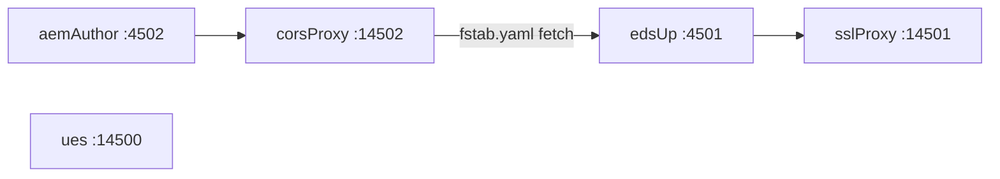

# lledsue-local-stack

Per-developer orchestrator for the five processes that make up the local AEM-EDS-UE stack. The skill itself hardcodes nothing about a particular developer's machine - it only knows:

1. The **five logical components** in the stack and the **dependency order** between them.
2. The **target port** each one binds to and a **health-check URL** it should answer.
3. How to **detach long-running processes** from the calling shell so they survive Cursor's Shell tool returning.

Everything else - what command actually starts AEM Author, where the AEM Cloud SDK is installed, where the Universal Editor Service checkout lives, whether the dev uses a wrapper script or calls `bin/start` directly - lives in **per-developer config** at [`tmp-workspace/local-stack.config.json`](../../../tmp-workspace/local-stack.config.json) (gitignored). The skill prompts the dev on first run, stores the answers, and replays them on subsequent calls.

The orchestration logic lives in this SKILL. The project also commits a small set of *portable, parameterized* helper scripts under [`dev/bin/`](../../../dev/bin/) (e.g. `aem-author-start.sh`, `eds-up-start.sh`, `eds-ssl-proxy-start.sh`) that do nothing developer-specific - they read paths from environment variables or auto-detect via `git rev-parse`. Per-developer paths still live only in `tmp-workspace/local-stack.config.json`.

## When to use

- "start / stop / restart / boot / kill / bring up / tear down the local stack"
- "start AEM" / "stop AEM" / "is AEM running?"
- "start UE locally" / "spin up the editor"
- "start just aem up" / "restart the ssl proxy"
- "fix the local stack" / "the editor isn't loading" - run `status` first to identify the failing component, then act on it

## Five components, in dependency order



| # | Component id | Port | Depends on | What it is |
|---|---|---|---|---|
| 1 | `aemAuthor`    | 4502  | -           | AEM author instance from the Cloud SDK quickstart JAR |
| 2 | `corsProxy`    | 14502 | aemAuthor   | HTTPS proxy in front of Author so UES can reach it under TLS |
| 2 | `ues`          | 14500 | -           | Universal Editor Service (independent) |
| 3 | `edsUp`        | 4501  | corsProxy   | `aem up` serving EDS code from the local checkout; fetches `fstab.yaml` via the corsProxy |
| 4 | `sslProxy`     | 14501 | edsUp       | HTTPS proxy in front of `aem up` so the UE canvas can iframe it under TLS |

`ues` (#2) has no upstream so it can start in parallel with `corsProxy`. The skill starts `corsProxy` first so that when `edsUp` boots a moment later, the proxy is already accepting connections for the fstab fetch.

The user's request "ssl proxy" maps to both `corsProxy` and `sslProxy`; they're separate because they sit on different ports and proxy different upstreams.

## Prerequisites & first-run bootstrap

Before any component can start, the machine needs: Java 21 (for AEM Author), the `aem` and `local-ssl-proxy` CLIs, the repo's `node_modules` (the cors proxy imports `http-proxy`), the self-signed certs in `dev/.local/`, and - on the Gen Digital fleet - the corporate CA trusted by Node. The repo ships one idempotent script that sets all of this up (everything except the Adobe-distributed UES):

```bash
bash dev/bin/bootstrap-prereqs.sh
```

Run it on first setup, or whenever `status` shows a component that never binds its port. It is safe to re-run; each step no-ops when already satisfied. After it runs, **open a new terminal** (or `source ~/.zshrc`) so `NODE_EXTRA_CA_CERTS` is in the environment, then start the stack.

When orchestrating from a Cursor Shell tool yourself, export the CA bundle in the same block before launching node-based components, because the python daemonizer execs a **non-login** `bash -c` that does not source `~/.zshrc`:

```bash
export NODE_EXTRA_CA_CERTS="$HOME/.certs/corp-ca-bundle.pem"
```

### Known prerequisite gotchas (all handled by `bootstrap-prereqs.sh`)

- **Corporate TLS interception breaks `npm install`.** Gen Digital laptops route HTTPS through a Zscaler / NortonLifeLock inspection proxy that re-signs certs with an internal root (`NortonLifeLock Inc. Private Root CA - GCS`, *not* the Zscaler root - that one is a decoy that does not cover GitHub). Node ships only Mozilla roots, so `npm install` dies with `UNABLE_TO_GET_ISSUER_CERT_LOCALLY` the moment it fetches a git tarball (e.g. `eslint-plugin-xwalk` from `codeload.github.com`). Fix: export the System keychain to a PEM bundle (`dev/bin/corp-ca-bundle.sh` -> `~/.certs/corp-ca-bundle.pem`) and set `NODE_EXTRA_CA_CERTS`. **Never** `npm config set strict-ssl false`.
- **Homebrew `openjdk@21` is keg-only.** `brew install openjdk@21` does *not* register the JDK with `/usr/libexec/java_home`, which is what `aem-author-start.sh` uses to find Java 21. Symlink it into the per-user JVM dir (`~/Library/Java/JavaVirtualMachines/`, which `java_home` also scans - no sudo needed). `aem-author-start.sh` also now falls back to `brew --prefix openjdk@21` directly.
- **`lsof` on a free port can abort an orchestration loop.** Under the Cursor Shell tool, `lsof -nP -iTCP:<port> -sTCP:LISTEN -t` exits non-zero (and may take down the surrounding loop) when nothing is listening - even with `set +e`. Guard every `lsof` command-substitution with a trailing `|| true`, and prefer **curl health checks** over `lsof` when reporting state for a port that may be empty (e.g. `ues` when UES is not installed).
- **`curl` against a not-yet-bound port can abort an orchestration loop too.** During the warmup poll, `curl` against a port whose process is still booting exits non-zero (commonly **7** "couldn't connect", or **28** on timeout). Inside a command substitution (`HTTP=$(http ...)`), that non-zero status propagates and aborts the whole block on the *first* failed probe if `set -e` leaked in from the caller's profile - even with a local `set +e`, because the failure surfaces as the block's exit status. The symptom is identical to the `lsof` trap: the orchestration "runs one component then stops with no error" (exit 7). Fix: the `http()` helper **must** end with `|| true` so it can never return non-zero (already baked into the helper above). Never call `curl` bare inside a `$(...)` in this skill - always route through `http()` / `probe()`, or append `|| true` yourself.
- **First AEM Author boot is slow.** A cold boot from the SDK quickstart (including the one-time JCR migration to persistent storage) can exceed the default `warmupSeconds`. A warm boot answers `login.html` in ~10s. Don't treat a single warmup miss as fatal - re-check via the final `status` table.

## Config schema

```json
{
  "edsRepoDir": "/Users/<you>/codes/eds/<project>",
  "aemCloudDir": "/Users/<you>/codes/aem/cloud",
  "uesDir": "/Users/<you>/codes/aem/cloud/universal-editor-service",
  "components": {
    "aemAuthor": {
      "label": "AEM Author",
      "port": 4502,
      "healthUrl": "http://localhost:4502/libs/granite/core/content/login.html",
      "healthAuth": "admin:admin",
      "warmupSeconds": 300,
      "start": "<the command you run to start AEM Author>",
      "stop":  "<the command you run to stop AEM Author>"
    },
    "corsProxy": {
      "label": "AEM HTTPS proxy (cors-pna-proxy)",
      "port": 14502,
      "healthUrl": "https://localhost:14502/libs/granite/core/content/login.html",
      "healthAuth": "admin:admin",
      "warmupSeconds": 10,
      "start": "...",
      "stop":  "..."
    },
    "ues": {
      "label": "Universal Editor Service",
      "port": 14500,
      "healthUrl": "https://localhost:14500/ping",
      "warmupSeconds": 10,
      "start": "...",
      "stop":  "..."
    },
    "edsUp": {
      "label": "aem up (EDS preview)",
      "port": 4501,
      "healthUrl": "http://localhost:4501/",
      "warmupSeconds": 15,
      "start": "...",
      "stop":  "..."
    },
    "sslProxy": {
      "label": "EDS HTTPS proxy (local-ssl-proxy)",
      "port": 14501,
      "healthUrl": "https://localhost:14501/",
      "warmupSeconds": 10,
      "start": "...",
      "stop":  "..."
    }
  }
}
```

`port`, `healthUrl`, `healthAuth`, `warmupSeconds`, and `label` are fixed by the skill - the dev never needs to touch them. Only `edsRepoDir`, `aemCloudDir`, `uesDir`, and each component's `start` / `stop` are per-developer. `edsRepoDir` is auto-detected from the cwd at every run; `aemCloudDir` and `uesDir` are prompted on first run.

### Template substitution

Before exec, the skill replaces these tokens in `start` / `stop`:

| Token | Resolves to |
|---|---|
| `{{edsRepoDir}}` | The `edsRepoDir` field (absolute path to the EDS checkout) |
| `{{aemCloudDir}}` | The `aemCloudDir` field (absolute path to the AEM Cloud SDK install, parent of `author/`) |
| `{{uesDir}}` | The `uesDir` field (absolute path to the Universal Editor Service checkout) |
| `{{port}}` | The component's configured `port` (e.g. `4502` for `aemAuthor`) |

So a portable `edsUp` command can be written as:

```text
bash {{edsRepoDir}}/dev/bin/eds-up-start.sh
```

And an `aemAuthor` command that needs the dev's Cloud SDK install can be written as:

```text
AEM_CLOUD_DIR={{aemCloudDir}} bash {{edsRepoDir}}/dev/bin/aem-author-start.sh
```

## Workflow

```
- [ ] Step 0: Preflight - on first run or a port that won't bind, run dev/bin/bootstrap-prereqs.sh.
- [ ] Step 1: Load tmp-workspace/local-stack.config.json or run init.
- [ ] Step 2: Detect action (init | start | stop | restart | force-stop | status | edit).
- [ ] Step 3: Resolve which components are in scope (all, in dependency order, or just the named ones).
- [ ] Step 4: Run commands, with detached starts and foreground stops.
- [ ] Step 5: Report port + health status table and canvas URL.
```

### Inline bash implementation

The full algorithm fits in ~80 lines of bash. The agent inlines it in a Shell-tool call rather than depending on any persistent script file - the orchestration logic itself lives only in this SKILL.md and in the per-developer config. (The repo does commit a small set of *portable, parameterized* helper scripts under `dev/bin/`; those run a single component each and never encode personal paths. See the "Portable scripts" hard rule at the bottom of this file.)

```bash
# At the top of every orchestration block:
set +e ; set +o pipefail

REPO="$(git rev-parse --show-toplevel)"
CFG="$REPO/tmp-workspace/local-stack.config.json"
LOGDIR="$REPO/tmp-workspace/local-stack-logs"
mkdir -p "$LOGDIR"

ORDER=(aemAuthor corsProxy ues edsUp sslProxy)
PROXIES=(corsProxy sslProxy)

is_proxy() { local p; for p in "${PROXIES[@]}"; do [ "$p" = "$1" ] && return 0; done; return 1; }
get()      { jq -r ".components.\"$1\".\"$2\" // \"\"" "$CFG"; }
resolve()  {
    local C="$1" P="$2"
    C="${C//\{\{edsRepoDir\}\}/$(jq -r '.edsRepoDir // ""' "$CFG")}"
    C="${C//\{\{aemCloudDir\}\}/$(jq -r '.aemCloudDir // ""' "$CFG")}"
    C="${C//\{\{uesDir\}\}/$(jq -r '.uesDir // ""' "$CFG")}"
    printf "%s" "${C//\{\{port\}\}/$P}"
}
http()     { local A=""; [ -n "$2" ] && A="-u $2"; curl -sk -o /dev/null -w "%{http_code}" $A "$1" --max-time 5 2>/dev/null || true; }   # trailing `|| true` is mandatory - see curl gotcha

start_component() {
    local ID="$1" S P U A W HTTP
    S=$(get "$ID" start); P=$(get "$ID" port); U=$(get "$ID" healthUrl)
    A=$(get "$ID" healthAuth); W=$(get "$ID" warmupSeconds); [ -z "$W" ] && W=30
    S=$(resolve "$S" "$P")
    echo "=== START $ID (:$P, warmup ${W}s) ==="
    echo "  cmd: $S"
    python3 -c '
import os, sys
if os.fork(): sys.exit(0)
os.setsid()
if os.fork(): sys.exit(0)
sys.stdin.close()
out = open(sys.argv[1], "a+")
os.dup2(out.fileno(), 1); os.dup2(out.fileno(), 2)
os.execvp("bash", ["bash", "-c", sys.argv[2]])
' "$LOGDIR/$ID.log" "$S"
    local i=0
    while [ "$i" -lt "$W" ]; do i=$((i+1)); sleep 1
        HTTP=$(http "$U" "$A")
        case "$HTTP" in
            2*|3*|401) echo "  ready after ${i}s (http=$HTTP)" ; return 0 ;;
            404)       is_proxy "$ID" && { echo "  proxy listening after ${i}s (http=404 - upstream warming)" ; return 0 ; } ;;
        esac
    done
    echo "  WARN: not healthy after ${W}s, last http=$HTTP"
    tail -30 "$LOGDIR/$ID.log" | sed 's/^/  | /'
    return 1
}

stop_component() {
    local ID="$1" S P
    S=$(get "$ID" stop); P=$(get "$ID" port); S=$(resolve "$S" "$P")
    echo "=== STOP $ID (:$P) ==="
    [ -z "$S" ] && { echo "  (no stop command)" ; return 0 ; }
    bash -c "$S" 2>&1 | tail -5 | sed 's/^/  /'
}

print_status() {
    printf "%-15s %-7s %-8s %-10s %s\n" id port pid http state
    printf "%-15s %-7s %-8s %-10s %s\n" --- ---- --- ---- -----
    local ID P U A PID HTTP STATE
    for ID in "${ORDER[@]}"; do
        P=$(get "$ID" port); U=$(get "$ID" healthUrl); A=$(get "$ID" healthAuth)
        PID=$(lsof -nP -iTCP:"$P" -sTCP:LISTEN -t 2>/dev/null | head -1) ; PID=${PID:-"-"}
        HTTP=$(http "$U" "$A") ; HTTP=${HTTP:-"---"}
        case "$HTTP" in 2*|3*|401) STATE=UP ;; 404) is_proxy "$ID" && STATE=proxy || STATE=down ;; *) STATE=down ;; esac
        printf "%-15s %-7s %-8s %-10s %s\n" "$ID" "$P" "$PID" "$HTTP" "$STATE"
    done
}

# Then dispatch: full chain, or scoped to specific component ids the user named.
# Always suffix component calls with `; true` so a single miss can't abort the chain.
```

For **stop**, dispatch each component in hardcoded reverse dependency order, then wait up to 120 s for the named ports to free before printing `print_status`:

```bash
stop_component sslProxy   ; true
stop_component edsUp      ; true
stop_component ues        ; true
stop_component corsProxy  ; true
stop_component aemAuthor  ; true

for i in $(seq 1 120); do
    BUSY=0
    for ID in "${ORDER[@]}"; do
        P=$(get "$ID" port)
        lsof -nP -iTCP:"$P" -sTCP:LISTEN -t >/dev/null 2>&1 && { BUSY=1 ; break ; }
    done
    [ "$BUSY" = "0" ] && break
    sleep 1
done
```

**Why hardcoded order, not `for ((i=${#ORDER[@]}-1; i>=0; i--))`**: the Cursor Shell tool runs commands through the dev's login shell, which on macOS is **zsh**. Zsh arrays are 1-indexed by default (`KSH_ARRAYS` off), so a C-style reverse loop walks `ORDER[4..0]` instead of `ORDER[5..1]` - the last component (`sslProxy` at index 5) is silently skipped on the first iteration, and an empty `ORDER[0]` is dispatched on the last. The hardcoded form is explicit, matches the dependency table at the top of this SKILL exactly, and works identically in bash and zsh. Value-based iteration (`for ID in "${ORDER[@]}"`) also works in both shells and is used freely elsewhere in the orchestration block (the port-wait loop, `print_status`); the trap is **only** numeric-index arithmetic over an array literal.

**Don't wait the full 120 s on a no-op stop.** The configured `stop` commands are pidfile-based. When a component was started by this skill's inline daemonizer (the common case), or after any crash, the stop script's pidfile is stale: it prints `PID <n> not alive` and exits 0 **without killing the process that is still listening on the port**. Watching for this saves ~2 minutes per shutdown:

- If a port is still `LISTEN` ~10 s after its stop command ran, **stop polling immediately and escalate to the port-based `force-stop` below** - don't burn the remaining 110 s waiting for a port nothing is going to free.
- Treat `stop` reporting "not alive" (or any stale-PID message) for a port that is still bound as a direct force-stop trigger, not a success.

For **restart**, run stop (including the wait) then start.

### Step 0: Preflight (first run / any component that won't bind)

If `tmp-workspace/local-stack.config.json` is missing, or `status` shows a component whose port never binds, the machine prerequisites are probably not in place. Run the idempotent bootstrap before (re)starting:

```bash
bash dev/bin/bootstrap-prereqs.sh
```

This installs Java 21 (+ registers it for `java_home`), the `aem` / `local-ssl-proxy` CLIs, the repo `node_modules`, the `dev/.local/` certs, and the corporate CA bundle (`NODE_EXTRA_CA_CERTS`). See "Prerequisites & first-run bootstrap" above. It does **not** install UES or start anything.

### Step 1: Load or init config

`tmp-workspace/local-stack.config.json` is gitignored (`tmp-workspace/` is already in [`.gitignore`](../../../.gitignore)).

Resolution:

1. If the file exists, parse it with `jq`. If parsing fails, treat it as missing.
2. `edsRepoDir` is always overwritten with `git rev-parse --show-toplevel` from the cwd - the repo path is the ground truth.
3. If `aemCloudDir` is missing or empty, prompt the dev once (see Step 1a) and merge the answer back into the file. Don't re-prompt on subsequent runs.
4. If `uesDir` is missing or empty, prompt the dev once (see Step 1a). Suggest `<aemCloudDir>/universal-editor-service` as the default option (it's the conventional layout) but always allow "Other".
5. For each component, if `start` or `stop` is missing/empty, prompt the dev (see Step 1a) and merge the answer back into the file.

### Step 1a: Init prompts

When the file is missing or any of `aemCloudDir`, `uesDir`, or any component's `start` command is empty, prompt the dev with `AskQuestion`. Group the prompts into **one** form when possible. Ask **start commands** upfront; ask **stop commands** lazily, the first time the dev triggers a stop on a component with no `stop` recorded.

#### Path prompts (asked once)

| Field | Prompt | Suggestions |
|---|---|---|
| `aemCloudDir` | "Where is your AEM Cloud SDK installed (the directory containing `author/`)?" | `$HOME/codes/aem/cloud` (common convention)<br/>"Other" - dev pastes their own path |
| `uesDir` | "Where is your Universal Editor Service checkout?" | `<aemCloudDir>/universal-editor-service` (default, sibling of `author/`)<br/>"Other" - dev pastes their own path |

`edsRepoDir` is **never** prompted; it's always derived from `git rev-parse --show-toplevel`.

#### Component start commands

For each component, present a small set of common starting points plus the implicit "Other" option that lets the dev paste an arbitrary command. **Do not invent generic defaults** - the suggestions should be specific enough to be recognisable, with the rest deferred to "Other". Prefer the portable repo-owned scripts under `{{edsRepoDir}}/dev/bin/` as the **first** option whenever one exists for that component.

| Component | Sample suggestions to surface in the picker |
|---|---|
| `aemAuthor.start`    | `AEM_CLOUD_DIR={{aemCloudDir}} bash {{edsRepoDir}}/dev/bin/aem-author-start.sh` (recommended - pins Java 21, idempotent persistent-storage symlink, optional truststore)<br/>`cd {{aemCloudDir}} && ./aem-cloud-setup.sh author`<br/>`cd {{aemCloudDir}}/author && CQ_PORT=4502 CQ_RUNMODE=author bash ./crx-quickstart/bin/start` (footgun - only works if Java 21 is *first* in `$PATH`; see "Java 21 PATH-pinning is non-optional" below) |
| `aemAuthor.stop`     | `AEM_CLOUD_DIR={{aemCloudDir}} bash {{edsRepoDir}}/dev/bin/aem-author-stop.sh` (recommended)<br/>`cd {{aemCloudDir}}/author && bash ./crx-quickstart/bin/stop` |
| `corsProxy.start`    | `bash {{edsRepoDir}}/dev/bin/aem-cors-proxy-start.sh` (recommended - vendored proxy, no `{{uesDir}}` needed)<br/>`bash {{uesDir}}/bin/aem-https-start.sh` (legacy upstream wrapper) |
| `corsProxy.stop`     | `bash {{edsRepoDir}}/dev/bin/aem-cors-proxy-stop.sh` (recommended)<br/>`bash {{uesDir}}/bin/aem-https-stop.sh` |
| `ues.start`          | `UES_DIR={{uesDir}} bash {{edsRepoDir}}/dev/bin/ues-start.sh` (recommended - foreground exec, the skill's own daemonizer is the single backgrounding layer)<br/>`bash {{uesDir}}/start.sh` (upstream's spawn.py wrapper - works, but stacks two daemonizers) |
| `ues.stop`           | `bash {{edsRepoDir}}/dev/bin/ues-stop.sh` (recommended - kills :14500 by lsof / pgrep)<br/>`bash {{uesDir}}/stop.sh` |
| `edsUp.start`        | `bash {{edsRepoDir}}/dev/bin/eds-up-start.sh` (recommended)<br/>`cd {{edsRepoDir}} && NODE_TLS_REJECT_UNAUTHORIZED=0 aem up --no-open --port {{port}}` |
| `edsUp.stop`         | `bash {{edsRepoDir}}/dev/bin/eds-up-stop.sh` (recommended) |
| `sslProxy.start`     | `bash {{edsRepoDir}}/dev/bin/eds-ssl-proxy-start.sh` (recommended) |
| `sslProxy.stop`      | `bash {{edsRepoDir}}/dev/bin/eds-ssl-proxy-stop.sh` (recommended) |

The `CQ_PORT` / `CQ_RUNMODE` prefix on the direct Author command (and inside `dev/bin/aem-author-start.sh`) is **non-optional** - the stock `crx-quickstart/bin/start` template defaults to `CQ_PORT=4502 CQ_RUNMODE=author`. The defaults happen to match Author, so calling it bare *appears* to work; the explicit env makes the intent visible and prevents a future re-introduction of a second AEM instance (e.g. a Publisher) from silently launching as a second Author on :4502 if you copy the bare command across.

**Java 21 PATH-pinning is non-optional.** `crx-quickstart/bin/start` resolves the bare command `java` against `$PATH` (it does NOT honour `$JAVA_HOME`). On a typical macOS dev box where `$PATH` begins with `/Library/Java/JavaVirtualMachines/jdk-11.jdk/Contents/Home/bin` (a very common default), AEM Cloud SDK 2026.x will silently launch on Java 11 and ~294 OSGi bundles - including Oak (the JCR repository), Sling content servlets, and Granite UI - will fail to resolve with `osgi.ee; (&(osgi.ee=JavaSE)(version=17))`. The Author "appears" to start: `/system/console/bundles` is reachable, the warmup poll on `/libs/granite/core/content/login.html` returns 404 indefinitely, and every `/content/*` request returns 404 because the content servlets never registered. The recommended portable script (`dev/bin/aem-author-start.sh`) handles this by detecting `JAVA_21_HOME` via `/usr/libexec/java_home -v 21` and prepending `$JAVA_21_HOME/bin` to `$PATH` before exec'ing `bin/start`. Any "direct" picker option that calls `bin/start` without first prepending Java 21 to `$PATH` is a footgun.

#### Concrete AskQuestion shape

Use a single `AskQuestion` call with all per-dev prompts as separate questions in one form. Per-question shape:

```json
{
  "id": "aemAuthor.start",
  "prompt": "Command to START AEM Author on port 4502:",
  "options": [
    { "id": "portable", "label": "AEM_CLOUD_DIR={{aemCloudDir}} bash {{edsRepoDir}}/dev/bin/aem-author-start.sh (recommended)" },
    { "id": "wrapper",  "label": "cd {{aemCloudDir}} && ./aem-cloud-setup.sh author" },
    { "id": "direct",   "label": "cd {{aemCloudDir}}/author && CQ_PORT=4502 CQ_RUNMODE=author bash ./crx-quickstart/bin/start" }
  ]
}
```

The agent maps the dev's choices (or pasted "Other" values) into the JSON config. The `port`, `healthUrl`, `healthAuth`, `warmupSeconds`, and `label` fields are static per-component values supplied by the skill - never prompted.

Stop commands are prompted the **first time** the dev triggers a stop on a component that lacks one. The shape is identical to start.

### Step 2: Detect action

| User says | Action |
|---|---|
| "start", "boot", "spin up", "bring up" | `start` |
| "stop", "shut down", "tear down" | `stop` |
| "restart", "bounce" | `restart` |
| "kill", "force stop" | `force-stop` |
| "is it running", "status" | `status` |
| "reconfigure aemAuthor", "edit my start command for ues" | `edit <componentId>` |
| "what command is configured for X" | `show <componentId>` |

If the user names a single component, scope the action to that component plus its transitive dependents (for `stop`) or dependencies (for `start`).

### Step 3: Resolve scope

`start` order: `aemAuthor`, `corsProxy`, `ues`, `edsUp`, `sslProxy`.
`stop` order (reverse): `sslProxy`, `edsUp`, `ues`, `corsProxy`, `aemAuthor`.

### Step 4: Run

#### Sandbox & permissions (Cursor Shell tool) - git + mutating stack actions outside sandbox

Every start / stop / force-stop / pidfile-cleanup block touches things **outside the repo**: it spawns and signals processes and reads/writes files under `aemCloudDir` and `uesDir` (e.g. `crx-quickstart/conf/cq.pid`). The Cursor Shell tool sandbox only grants writes to the workspace and **blocks sending signals to processes**, so any of these run *inside* the sandbox fail in confusing, partial ways:

- A `kill` loop **silently stops after the first iteration** - the first signal trips the sandbox and aborts the whole block, so only one component dies.
- `rm` of a stale pidfile the dev owns, with no immutable flags, returns `rm: ...: Operation not permitted`.
- The graceful AEM stop logs an `org.apache.sling.launchpad.app.ControlListener.shutdownServer` error and its kill fallback can't land.

**Rule of thumb: anything that starts, stops, signals, removes files for this stack, or runs any `git ...` command must use `required_permissions: ["all"]` (outside the sandbox).** This includes read-style git calls such as `git rev-parse --show-toplevel`.

Non-git read-only probes (`curl` health checks, `lsof`) may remain sandboxed when run in isolation, but if they are in a mixed block that includes git, run the whole block outside sandbox.

This requirement changes sandbox context only - it does **not** bypass command allowlist/policy controls.

#### Detached start

Long-running components (every `start` command in this stack) must survive the Cursor Shell tool returning. The skill wraps every start command with an inline double-fork + `setsid` daemonizer written as a one-shot `python3 -c` invocation - no external script file needed:

```bash
set +e   # see "set -e defence" below
LOG="$REPO/tmp-workspace/local-stack-logs/<componentId>.log"
mkdir -p "$(dirname "$LOG")"
python3 -c '
import os, sys
if os.fork(): sys.exit(0)
os.setsid()
if os.fork(): sys.exit(0)
sys.stdin.close()
out = open(sys.argv[1], "a+")
os.dup2(out.fileno(), 1); os.dup2(out.fileno(), 2)
os.execvp("bash", ["bash", "-c", sys.argv[2]])
' "$LOG" "$RESOLVED_START_CMD"
```

`$RESOLVED_START_CMD` is the component's stored `start` with `{{edsRepoDir}}` and `{{port}}` substituted.

After dispatch, the skill waits up to `warmupSeconds` for `healthUrl` to answer with one of:

- **2xx** - up
- **3xx** - up (redirect; the process is bound and responding)
- **401** - up (AEM login redirect counts; the OSGi HTTP service is alive)
- **404** - ambiguous for **proxies** (corsProxy / sslProxy). A proxy that's listening will return 404 while its upstream is still booting. Treat 404 as "process up, upstream not yet ready", not as a hard failure - move on to the next component and re-check at the final `status` table. For non-proxy components, 404 is a real miss.

If the wait times out, the skill surfaces the last 30 lines of the component's log and **records the miss** but does not abort the chain - subsequent components may bring up the missing upstream and the proxy can recover. The final `status` table is what the dev sees as the source of truth.

#### `set -e` defence

When invoked by an agent through the Shell tool, the calling zsh / bash may have inherited `set -e` from a parent profile. A start_component that returns non-zero (warmup miss) will then abort the whole chain silently - which manifests as "the script ran one component then stopped with no error". Two defences are mandatory:

1. `set +e` at the top of every orchestration block.
2. Suffix every `start_component <id>` line with `; true` (or wrap with `|| true`) so the function's return value can never propagate up.

```bash
set +e
start_component aemAuthor    ; true
start_component corsProxy    ; true
start_component ues          ; true
start_component edsUp        ; true
start_component sslProxy     ; true
```

#### Foreground stop

Stop commands run synchronously in the same Shell tool call - by then nothing is waiting on the calling shell. The skill waits up to 60 s per AEM JVM and 10 s per node process for the port to free, then reports status.

#### `force-stop` (last resort)

Run this **outside the sandbox** (`required_permissions: ["all"]`) - see [Sandbox & permissions](#step-4-run) above; a sandboxed kill loop dies after the first signal. Skip the dev's stop commands. Send `TERM` first with a short grace window (the AEM JVM needs the longest), then escalate to `-9` only for ports still listening - a hard `-9` straight at the JVM is exactly what orphans its pidfiles:

```bash
for PORT in $PORTS_IN_REVERSE_ORDER; do
  PID=$(lsof -nP -iTCP:$PORT -sTCP:LISTEN -t 2>/dev/null | head -1 || true)
  [ -n "$PID" ] && kill -TERM "$PID" 2>/dev/null
done
# grace window for TERM (poll up to ~60 s for ports to free), then:
for PORT in $PORTS_IN_REVERSE_ORDER; do
  PID=$(lsof -nP -iTCP:$PORT -sTCP:LISTEN -t 2>/dev/null | head -1 || true)
  [ -n "$PID" ] && kill -9 "$PID" 2>/dev/null
done
```

Then clean up known stale pidfiles in the dev's AEM directories if they exist (we discover those by parsing the dev's `stop` commands - never by hardcoding paths). In particular, a force-killed AEM JVM leaves `<aemCloudDir>/author/crx-quickstart/conf/cq.pid` **and** `controlport` behind pointing at the dead PID; the next *graceful* `bin/stop` then fails with the `ControlListener` error above. Confirm `:4502` is free, verify the PID in `cq.pid` is not running, then remove both files (outside the sandbox) so the next clean stop works.

#### `status`

For each component:

1. `lsof -nP -iTCP:<port> -sTCP:LISTEN -t || true` -> is anything listening? (the `|| true` guards the free-port abort)
2. `curl -sk -o /dev/null -w '%{http_code}' [-u <healthAuth>] <healthUrl> --max-time 5 || true` -> is it healthy? (the `|| true` guards the not-yet-bound abort)

Print a single table with `id`, `port`, `pid`, `http`, `state`.

### Step 5: Confirm

After `start`, print:

```text
Local stack up:
  aemAuthor      <healthUrl>     pid=...  http=...
  corsProxy      ...
  ues            ...
  edsUp          ...
  sslProxy       ...

UE canvas:
  https://author-p149556-e1749225.adobeaemcloud.com/ui#/@symantec/aem/universal-editor/canvas/localhost:14502/{{contentPath}}
```

The canvas host and org segment are the published values for this project, documented in [`docs/universal-editor-local-setup.md`](../../../docs/universal-editor-local-setup.md). If they ever change, the doc is the source of truth and gets updated first.

After `stop` or `force-stop`, print the status table so the dev sees which ports actually freed.

## Running scripts under a `*.lifelock.norton.com` origin

Some scripts only work when invoked from a `*.lifelock.norton.com` host - typically because the target API whitelists `Host` / `Origin` / `Referer` on that pattern, or relies on cookies scoped to `.lifelock.norton.com`. Front local AEM Author (`:4502`) at `https://np.lifelock.norton.com/` so those scripts hit your local stack instead of the real environment:

```bash
# one-time: `npm i -g local-ssl-proxy`; add `127.0.0.1 np.lifelock.norton.com` to /etc/hosts
sudo local-ssl-proxy --source 443 --target 4502 --cert dev/.local/certificate.pem --key dev/.local/key.pem
# stop: sudo lsof -nP -iTCP:443 -sTCP:LISTEN -t | xargs sudo kill
```

Caveats: cert SAN is `localhost,127.0.0.1` so `curl -k` works but Chrome rejects with `ERR_CERT_COMMON_NAME_INVALID`. HSTS / cookies / SWs from real `lifelock.norton.com` apply here too - use a Chrome guest profile if you also browse production.

## Hard rules

- **Never** hardcode any path under a specific developer's machine (e.g. `/Users/<someone>/codes/aem/cloud/...`) inside this skill, inside `dev/bin/`, or anywhere else committed to git. Every machine-specific path lives in the dev's `tmp-workspace/local-stack.config.json`.
- **Never** auto-edit scripts under the dev's AEM Cloud SDK directory or under the dev's UES checkout. They are personal scripts owned by the dev and shared across all of that dev's EDS projects.
- **Never** assume `aem-cloud-setup.sh`, the `aem:cloud:*` zsh aliases, or any other personal wrapper exists. Suggest them as options during init - never call them unconditionally.
- **Never** silently overwrite the dev's stored `start` / `stop` commands. If a command no longer works, surface the error and prompt for a replacement.
- **Never** start components in parallel - respect the dependency order in the table above.
- **Never** invoke `force-stop` as a default. Always try `stop` first.
- **Never** commit `tmp-workspace/local-stack.config.json`.
- **Always** substitute `{{edsRepoDir}}`, `{{aemCloudDir}}`, `{{uesDir}}`, and `{{port}}` in commands before exec. A token that's not configured resolves to the empty string - the resulting command will fail loudly, which is the correct outcome.
- **Always** wrap `start` commands with the inline python3 daemonizer when invoked from a Cursor Shell tool - even if the dev's command already does its own backgrounding, the daemonizer is a no-op safety net.

### Portable scripts allowed under `dev/bin/`

The repo may commit shell scripts under [`dev/bin/`](../../../dev/bin/) **only** if they satisfy all of:

1. They take per-developer paths via environment variables (`AEM_CLOUD_DIR=...`) or auto-detect via `git rev-parse --show-toplevel`.
2. They never embed `/Users/<name>/...`, `$HOME/codes/...`, or any other developer-specific default.
3. They run a single component or single concern - never the whole stack. Whole-stack orchestration is the SKILL's job.

Canonical examples that satisfy this rule:

- `dev/bin/bootstrap-prereqs.sh` - idempotent one-time machine setup (Java 21, global CLIs, repo `npm install`, certs, corp CA). A single concern (prepare the machine); never starts a service.
- `dev/bin/corp-ca-bundle.sh` - exports the System keychain to `~/.certs/corp-ca-bundle.pem`. No paths to encode (`$HOME` / overridable `LL_CORP_CA_BUNDLE`).
- `dev/bin/aem-author-start.sh` / `aem-author-stop.sh` - require `AEM_CLOUD_DIR`.
- `dev/bin/aem-cors-proxy-start.sh` / `aem-cors-proxy-stop.sh` - auto-detect repo, run the vendored `cors-pna-proxy.cjs` against `dev/.local/` certs. No `UES_DIR` needed.
- `dev/bin/ues-start.sh` / `ues-stop.sh` - require `UES_DIR` for `start`; `stop` uses port-based kill on :14500.
- `dev/bin/eds-up-start.sh` / `eds-up-stop.sh` - auto-detect repo via `git rev-parse`.
- `dev/bin/eds-ssl-proxy-start.sh` / `eds-ssl-proxy-stop.sh` - auto-detect repo, use `dev/.local/` certs.
- `dev/bin/cors-pna-proxy.cjs` - vendored Node module (no paths to encode).
- `dev/bin/gen-tls-certs.sh` - writes to `dev/.local/` relative to the script.

Anything that needs a hardcoded `/Users/<name>/...` path is **not** allowed under `dev/bin/`; put the path in `tmp-workspace/local-stack.config.json` and reference it via the SKILL's substitution tokens instead.
