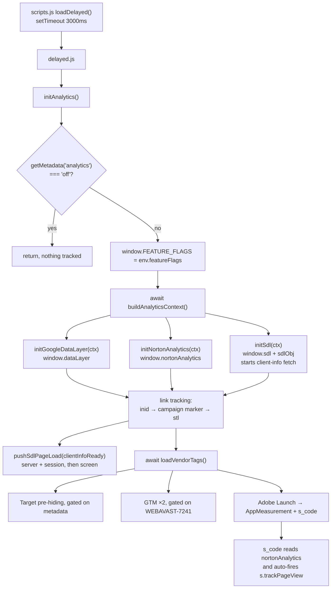

# Analytics implementation reference

How analytics is wired in this Edge Delivery project: which module builds what,
in what order, where each value comes from, and what a developer has to do to
instrument a new block.

This is a description of the code as it stands. For the *why* behind the design
— the investigation, the blockers, the decisions and their alternatives — see
[Adobe Analytics and SDL enablement for AVG EDS](./analytics-sdl-enablement.md).
Section 10 of the [EDS + UE development guide](./eds-ue-development-guide.md#10-analytics-in-eds)
predates this implementation and describes the intended shape rather than the
shipped code; treat this document as authoritative where they disagree.

## Contents

- [At a glance](#at-a-glance)
- [Module map](#module-map)
- [Boot sequence](#boot-sequence)
- [The shared page context](#the-shared-page-context)
- [The nortonAnalytics data layer](#the-nortonanalytics-data-layer)
- [The sdl and sdlObj data layers](#the-sdl-and-sdlobj-data-layers)
- [The SDL page-load events](#the-sdl-page-load-events)
- [Adobe Analytics: the page-load beacon](#adobe-analytics-the-page-load-beacon)
- [Adobe Analytics: anchor and button click tracking](#adobe-analytics-anchor-and-button-click-tracking)
- [The inid layer](#the-inid-layer)
- [Campaign markers](#campaign-markers)
- [Instrumenting a new block](#instrumenting-a-new-block)
- [Everything else in the stack](#everything-else-in-the-stack)
- [Current gaps and caveats](#current-gaps-and-caveats)
- [Debugging checklist](#debugging-checklist)


## At a glance

Three data layers are built client-side from the URL, page metadata and
`scripts/env.js`, then the MarTech vendor tags are loaded on top of them:


| Object                         | Consumer                                        | Built by                                 |
| ------------------------------ | ----------------------------------------------- | ---------------------------------------- |
| `window.nortonAnalytics`       | Adobe Analytics (Norton `s_code`)               | `scripts/analytics/norton-analytics.js`  |
| `window.sdl` / `window.sdlObj` | GTM container `GTM-WPC6R3K` (Single Data Layer) | `scripts/analytics/sdl.js`               |
| `window.dataLayer`             | GTM container `GTM-PZ48F8`                      | `scripts/analytics/google-data-layer.js` |

On top of those, four things are reported:

- **Adobe Analytics page load** — fired by the Norton `s_code` itself, which
  reads `window.nortonAnalytics` synchronously as it parses. Our job is to have
  that object complete and correct before Adobe Launch loads.
- **Adobe Analytics anchor click** — fired by `scripts/analytics/global-stl.js`
  via `s.tl(true, 'o', linkName)` with `prop41`/`eVar41`, driven by a
  `data-template-stl` attribute that blocks set on their anchors.
- **The SDL `screen` page view** — pushed by
  `scripts/analytics/global-sdl.js` onto `window.sdl`, after `server` and
  `session`.
- **inid and campaign markers** — `scripts/analytics/global-inid-link.js` and
  `scripts/analytics/global-campaign-marker.js` annotate outgoing links so the
  destination (a cart, a download, the next page) can attribute the click.

Everything runs in the **delayed phase** (`scripts/delayed.js`, +3s after lazy).

## Module map

```
scripts/
├── delayed.js                     entry point — calls initAnalytics()
├── analytics.js                   back-compat re-export shim, prefer analytics/
├── env.js                         report suite, Launch URL, GTM ids, feature flags
├── analytics/
│   ├── index.js                   orchestrator, ordering, analytics-off gate
│   ├── norton-analytics.js        window.nortonAnalytics  (Adobe Analytics)
│   ├── sdl.js                     window.sdl / window.sdlObj + client-info fetch
│   ├── global-sdl.js              SDL server / session / screen page-load pushes
│   ├── google-data-layer.js       window.dataLayer        (GTM)
│   ├── global-stl.js              s.tl anchor click tracking
│   ├── global-inid-link.js        data-inid: localStorage / s.tl / ?inid= routes
│   ├── global-campaign-marker.js  campaignMarker on cart links
│   ├── analytic-helper.js         ≤token≥ template compiler, URL parsing, link types
│   └── vendor-tags.js             Target pre-hiding, GTM ×2, Adobe Launch
└── util/
    ├── context.js                 shared page context consumed by all three builders
    ├── locale.js                  site_language / site_country resolution
    ├── path.js                    content segments, site sections, vanity path
    ├── screen-name.js             `locale | path` screen_name builder
    ├── page-id.js                 deterministic UUID v5 pageId / screenId
    ├── user-agent.js              os / browser / platform detection for session.platform
    ├── variant.js                 ?expid= experiment overrides
    └── constants.js               MISSING, PAGE_GROUP, DEFAULT_LOCALE
```

`scripts/analytics.js` exists only so older imports keep working. New code should
import from `scripts/analytics/index.js` or the specific module.

## Boot sequence



The ordering in `scripts/analytics/index.js` is load-bearing, not cosmetic:

```36:62:scripts/analytics/index.js
export default async function initAnalytics() {
  if (isAnalyticsDisabled()) return;

  window.FEATURE_FLAGS = env.featureFlags || [];

  const ctx = await buildAnalyticsContext(getMetadata);

  // Data layer objects before any MarTech consumers.
  initGoogleDataLayer(ctx);
  initNortonAnalytics(ctx);
  const clientInfoReady = initSdl(ctx);

  // Link tracking, in avast2 `defer.js` order.
  initGlobalInidLink();
  initGlobalCampaignMarker();
  initGlobalStl();

  // Chained off client-info so GTM-WPC6R3K sees `client` before `screen`.
  pushSdlPageLoad(clientInfoReady);

  await loadVendorTags();
}
```

Four constraints to preserve when editing this function:

- **Data layers must exist before** `loadVendorTags()`**.** The `s_code` latches
  `enableAdobeAnalytics = false` permanently if `window.nortonAnalytics` is
  missing when it parses, which silently kills every beacon for the page.
- **The three link-tracking modules must run after** `initNortonAnalytics()`,
  because their template tokens resolve against `window.nortonAnalytics`. They
  may run before Launch, since the click handlers only dereference `window.s` at
  click time.
- **inid runs before the campaign marker.** Both rewrite external hrefs, so
  their relative order decides query-parameter order. This mirrors avast2's
  `defer.js`.
- `pushSdlPageLoad` **is not awaited.** GTM picks up entries pushed either side
  of its own bootstrap, so holding the vendor tags for the client-info fetch
  would only delay Launch.


### The analytics-off switch

`getMetadata('analytics') === 'off'` short-circuits everything — no data layers,
no vendor tags, no click tracking. It is exposed to authors as a page-property
select (`models/_page.json`) and is intended for legal pages, typically applied
in bulk via a path pattern rather than page by page.

## The shared page context

`scripts/util/context.js` resolves the page once and hands the same object to all
three data-layer builders, so a value like `page_name` cannot drift between them.


| Context field                 | Source                                                               | Notes                                                          |
| ----------------------------- | -------------------------------------------------------------------- | -------------------------------------------------------------- |
| `siteLanguage`, `siteCountry` | `<html lang>` → `lang` metadata → URL locale prefix → `en-ww`        | `es-lm` remaps to `es-lam`, `en-uk` to `en-gb`                 |
| `locale`                      | ``${siteLanguage}-${siteCountry}``                                   |                                                                |
| `contentSegments`             | `location.pathname` minus a leading locale segment                   | `/en-us/products/vpn` → `['products', 'vpn']`                  |
| `pageName`                    | `page-name` metadata → last content segment → `missing`              | Lowercased, `[^\w\d\s\-&.]` stripped                           |
| `contentTitle`                | `content-title` metadata → `pageName`                                |                                                                |
| `siteSection`                 | `site-section` metadata → `avg.com`                                  |                                                                |
| `siteSubSection`              | `site-sub-section` metadata → first content segment → `na`           | Path fallback needs ≥2 segments                                |
| `siteSubSubSection`           | `site-sub-sub-section` metadata → second content segment → `missing` | Path fallback needs ≥3 segments                                |
| `pageType`                    | `page-type` metadata                                                 | **Empty string when unset**                                    |
| `lineOfBusiness`              | `line-of-business` metadata → `consumer`                             |                                                                |
| `pageId`                      | UUID v5 of the normalized pathname                                   | Deterministic replacement for AEM `jcr:uuid`                   |
| `vanityPath`                  | Content segments joined, lowercased                                  |                                                                |
| `relativePath`                | Content segments normalized and joined                               |                                                                |
| `screenName`                  | `` `${locale}                                                        | ${locale}/${path}` ``                                          |
| `pageGroup`                   | `PAGE_GROUP` constant                                                | Hardcoded `'Homepage'` — see [gaps](#current-gaps-and-caveats) |


### Variant experiments

A `?expid=` query parameter is matched against the `variant-mapping` page
metadata, a JSON array authored as:

```json
[{ "expIdParam": "v2", "pageName": "page-v2", "contentTitle": "Title V2" }]
```

A match overrides `contentTitle` and/or `pageName`. When `pageName` is
overridden, `screenName` is rebuilt from the variant slug and the vanity path is
deliberately ignored, so `screen_name` tracks the variant rather than the URL.

### Locale resolution

`<html lang>` is authoritative because `scripts/scripts.js` sets it from the
`lang` metadata during the eager phase, before analytics runs:

```154:155:scripts/scripts.js
  const lang = getMetadata('lang');
  document.documentElement.lang = lang || 'en';
```

Note that only a **full** locale token (`en-us`, `en-ww`) is accepted as a locale
hint. A bare `en` falls through to the URL prefix and then to the `en-ww`
default, and a path segment like `santhosh-test` is deliberately not matched as
a locale.

## `window.nortonAnalytics`

The Adobe Analytics data layer. The Norton `s_code` reads it directly and passes
it to `s.trackPageView()`, so every key here is a reporting dimension.

Built by `buildNortonAnalytics(ctx)`:


| Key                    | Value                                          | Source                                        |
| ---------------------- | ---------------------------------------------- | --------------------------------------------- |
| `account`              | `symanteccom` (prod) / `veritasdev` (non-prod) | `env.analyticsAccount`, host-derived          |
| `site_country`         | e.g. `us`                                      | context                                       |
| `site_language`        | e.g. `en`                                      | context                                       |
| `content_title`        |                                                | `content-title` metadata, variant-overridable |
| `content_format`       | `html`                                         | constant                                      |
| `content_type`         | `page`                                         | constant                                      |
| `site_section`         | default `avg.com`                              | metadata                                      |
| `site_sub_section`     |                                                | metadata or path                              |
| `site_sub_sub_section` |                                                | metadata or path                              |
| `page_name`            |                                                | metadata or last path segment                 |
| `lang_ctry_code`       | `''`                                           | Avast limited-locale prepend; empty for AVG   |
| `environment`          | `prod` / `dev`                                 | `env.analyticsEnvironment`                    |


`initNortonAnalytics()` then applies three conditional keys:


| Key         | Condition                                                                | Behaviour                                                                                                        |
| ----------- | ------------------------------------------------------------------------ | ---------------------------------------------------------------------------------------------------------------- |
| `inid`      | `localStorage.inid` is set                                               | Copied onto the object, then **removed** from `localStorage` — a one-shot handoff from the previous page's click |
| `spa`       | `page-type` metadata is `onboarding`                                     | Set to `true`, which **suppresses the automatic page-view beacon** (see below)                                   |
| `avast-sku` | `page-type` is `onboarding`, `Benefits` or `75D`, and `?sku=` is present | Uppercased value of the query parameter                                                                          |


```39:63:scripts/analytics/norton-analytics.js
export default function initNortonAnalytics(ctx) {
  window.nortonAnalytics = buildNortonAnalytics(ctx);

  try {
    const inid = localStorage.getItem('inid');
    if (inid) {
      window.nortonAnalytics.inid = inid;
      localStorage.removeItem('inid');
    }
  } catch {
    // localStorage may be unavailable
  }

  const pageType = getMetadata('page-type');
  if (pageType === 'onboarding') {
    window.nortonAnalytics.spa = true;
  }

  if (SKU_PAGE_TYPES.has(pageType)) {
    const sku = window.location.search.match(/(?<=sku=)[^&]+/);
    if (sku) {
      window.nortonAnalytics['avast-sku'] = sku[0].toUpperCase();
    }
  }
}
```

The `s_code` also writes back to this object: after it fires the page view it
sets `nortonAnalytics.pagetagfired = true`, which is the most convenient runtime
signal that page-load tracking worked.

## `window.sdl` and `window.sdlObj`

The Single Data Layer, consumed by GTM container `GTM-WPC6R3K`. Two distinct
things share the name:

- `window.sdl` — an *event array*, GTM-style. Consumers push event objects
onto it and GTM reacts. This is the actual data layer.
- `window.sdlObj` — a plain *payload object* describing the current screen.
It is the source material that SDL event pushes are built from.

`buildSdlObj(ctx)` produces:


| Key              | Source                                          |
| ---------------- | ----------------------------------------------- |
| `pageType`       | `page-type` metadata, empty string when unset   |
| `lineOfBusiness` | `line-of-business` metadata, default `consumer` |
| `screenId`       | UUID v5 of the pathname                         |
| `screen.name`    | `` `${locale} \| ${relativePath}` ``            |

`initSdl()` creates both objects and starts the client-info fetch, returning a
promise the caller uses to order the page-load pushes:

```scripts/analytics/sdl.js
export default function initSdl(ctx) {
  window.sdl = window.sdl || [];
  window.sdlObj = buildSdlObj(ctx);
  return withTimeout(fetchClientInfo());
}
```

### The client-info fetch

`fetchClientInfo()` requests `https://www.avg.com/client-info.js?fetch=true`
(`env.clientInfoUrl`), parses the JSON body and pushes it onto `window.sdl` as
the `client` event. Failures resolve rather than reject, so a slow or blocked
endpoint can never break page decoration.

It is gated by `canFetchClientInfo()`, which restricts it to `avg.com` and its
subdomains. This is not a caution — it is a hard limit. The endpoint answers
`200` with `content-type: application/json` but sends **no**
`Access-Control-Allow-Origin` header for any origin:

```bash
curl -s -D - -o /dev/null \
  -H "Origin: https://main--eds-ue-avg-san--santhoshkumarsrg.aem.page" \
  "https://www.avg.com/client-info.js?fetch=true" | grep -i access-control
# (no output)
```

avast2 gets away with the same absolute URL because it is served same-origin
there. So **the** `client` **event can only ever fire on avg.com**, and fetching
from anywhere else buys nothing but a CORS console error. Removing the gate does
not fix the gap; it needs a CORS header on the endpoint or a same-origin proxy.

Because the fetch is skipped off avg.com, the promise `initSdl()` returns is
already resolved there, so the `screen` push is not delayed. On avg.com it is
bounded by `CLIENT_INFO_TIMEOUT_MS` (1s), trading one dimension for a guaranteed
page view.

### `pageId` / `screenId`

Traditional AEM uses the JCR node UUID. EDS has no repository, so
`scripts/util/page-id.js` derives an RFC 4122 UUID v5 from the normalized
pathname using Web Crypto SHA-1 and a fixed namespace. Same path, same id, on
every host and every visit — which is the property reporting needs. Note that
`crypto.subtle` requires a secure context, which is why
`buildAnalyticsContext()` is `async`.

## The SDL page-load events

`scripts/analytics/global-sdl.js` performs the actual page-load pushes onto
`window.sdl`, in two calls, ported from avast2's `global-sdl.js`:

```js
window.sdl.push(buildServerSession()); // { server: {…}, session: {…} }
window.sdl.push(buildScreen()); // { event: 'screen', screen: {…} }
```

`server` and `session` carry environment and client facts:

| Key                   | Value                                                       |
| --------------------- | ----------------------------------------------------------- |
| `server.provider`     | `AEM`                                                       |
| `server.platform`     | `WEB`                                                       |
| `server.env`          | `nortonAnalytics.environment` (`dev` / `qa` / `stage` / `prod`) |
| `server.dataCenter`   | `-` (not applicable to EDS)                                 |
| `server.sdlVersion`   | `2021-05-05/v1`                                             |
| `session.countryCode` | `nortonAnalytics.site_country`                              |
| `session.secChUa`     | `navigator.userAgentData.brands`, else parsed from the UA    |
| `session.platform`    | Lowercased OS name from `scripts/util/user-agent.js`         |
| `session.mobile`      | `navigator.userAgentData.mobile`, else UA-derived            |

`screen` is the SDL page view, built from `window.sdlObj` plus the URL:

| Key                    | Value                                                        |
| ---------------------- | ------------------------------------------------------------ |
| `screen.location`      | `protocol`, `hostname`, `path`, `hash`, `params`, `woParams`, `url` |
| `screen.locale`        | `` `${site_language}-${site_country}` ``                     |
| `screen.screenCategory`| `core`                                                       |
| `screen.title`         | `document.title`                                             |
| `screen.type`          | `sdlObj.pageType`                                            |
| `screen.lineOfBusiness`| `sdlObj.lineOfBusiness`                                      |
| `screen.screenId`      | `sdlObj.screenId`                                            |
| `screen.name`          | `sdlObj.screen.name`                                         |

The push is chained off the client-info promise so `GTM-WPC6R3K` sees `client`
before `screen` when both are available. The whole function is wrapped in a
`try`/`catch`: a missing SDL page view must not break the rest of the page.

### The user-agent utility

`session.platform` needs an OS name, which `navigator.userAgentData` does not
provide. `scripts/util/user-agent.js` ports avast2's `user-agent-detection.js`
`os`, `browser` and `platform` interfaces and is exposed as
`window.userAgentDetection` for any third-party script that expects it. avast2's
`init()` and `getHash()` are **not** ported, since they depend on a
`window.osPlatforms` global that only exists in the AEM delivery.

## Adobe Analytics: the page-load beacon

**Nothing in this repo calls** `s.trackPageView()`**.** The page-view beacon is
fired by the Norton `s_code_norton_min.js`, which Adobe Launch loads. Its last
statement is, in effect:

```js
!enableAdobeAnalytics || nortonAnalytics.spa || nortonAnalytics.pagetagfired
  || nortonAnalytics.disablePVtagfire
  || (s.trackPageView(nortonAnalytics), nortonAnalytics.pagetagfired = !0);
```

This is the "s_code auto-fire" architecture (Option A in the enablement doc),
chosen for parity with avast2. It has four consequences worth internalizing:

1. `window.nortonAnalytics` **must be complete before Launch loads.** The
  `s_code` reads it synchronously while parsing. A late-arriving value is not
   late — it is missing.
2. `nortonAnalytics.spa` **must stay unset** on ordinary pages. Setting it opts
  the page out of the automatic fire, and nothing in this codebase fires a
   replacement. Only `page-type: onboarding` sets it today.
3. **The beacon needs** `'unsafe-eval'` **in the CSP.** The `s_code` assigns
  `s.p_gpv` and `s.p_gvf` with the `Function` constructor. Without the
   allowance it throws `EvalError` at top level, which aborts the rest of the
   file — including the line above. Both `head.html` and `404.html` carry the
   allowance:

```1:5:head.html
<meta
  http-equiv="Content-Security-Policy"
  content="script-src 'nonce-aem' 'strict-dynamic' 'unsafe-inline' 'unsafe-eval' http: https:; base-uri 'self'; object-src 'none';"
  move-to-http-header="true"
>
```

1. **The report suite follows the hostname, not the branch.** `scripts/env.js`
  uses an exact-match `PROD_HOSTS = ['avg.com', 'www.avg.com']` allowlist, so
   no `*.aem.page` or `*.aem.live` preview can ever report into production. This
   is deliberately structural: a mis-named branch cannot corrupt production data.

Beacon endpoint: `oms.norton.com/b/ss/{account}/...`.

## Adobe Analytics: anchor and button click tracking

Two independent mechanisms produce click beacons, and they are easy to confuse
because both show up as `b/ss` requests.

### 1. AppMeasurement automatic link tracking (free, no code)

The `s_code` enables `s.trackExternalLinks` and `s.trackDownloadLinks`, so exit
links fire `pe=lnk_e` and download links fire `pe=lnk_d` with no involvement from
this repo. Four properties of it matter:

- It only fires for links the `s_code` considers external.
`s.linkInternalFilters` covers `avg.com`, `avast.com`, `norton.com` and
sibling brands, so cross-brand links are deliberately suppressed.
- **On preview hosts the classification is wrong in a flattering direction.**
`*.aem.page` / `*.aem.live` appear in no filter entry, so same-origin links
look external and fire a spurious `lnk_e`. Do not read a preview exit-link
beacon as proof that a link is tracked in production.
- It carries **no custom variables** — `s.linkTrackVars` is `"None"`, so there is
no `prop41`/`eVar41`. Link naming comes from ActivityMap reading the link text.
- It cannot express a same-page anchor at all.


### 2. Branded STL tracking via `global-stl.js` (what we control)

`scripts/analytics/global-stl.js` is the port of avast2's `global-stl`. A block
opts an anchor in by setting a link-name template on it; the module compiles the
template, stores the result in `data-stl`, and binds a click handler that sends a
custom link beacon:

```30:45:scripts/analytics/global-stl.js
function createClickHandler(sourceProp, nameKey) {
  return (e) => {
    const { s } = window;
    if (!s || typeof s.tl !== 'function') return;

    const elem = e[sourceProp];
    const linkName = elem?.dataset?.[nameKey];
    // A link pointing at the page it already sits on is not a navigation to report.
    if (!linkName || elem.href === window.location.href) return;

    s.linkTrackVars = LINK_TRACK_VARS;
    s.prop41 = PROP_41;
    s.eVar41 = PROP_41;
    s.tl(true, 'o', linkName);
  };
}
```

`LINK_TRACK_VARS` is `'prop41,eVar41'` and `PROP_41` is `'avg.com'` — the brand
identifier that distinguishes an authored AVG click from AppMeasurement's
automatic exit-link beacon. On the wire that appears as `pe=lnk_o`,
`pev2=<compiled name>`, `c41=avg.com`, `v41=D=c41`.

#### The two opt-in attributes


| Attribute                  | Selector                                     | Token sources                                 | Scan scope                                                  |
| -------------------------- | -------------------------------------------- | --------------------------------------------- | ----------------------------------------------------------- |
| `data-template-stl`        | `[data-template-stl]:not([data-stl])`        | `window.nortonAnalytics` + `getUrlInfo(href)` | Whole document at init, or a dispatched subtree             |
| `data-custom-template-stl` | `[data-custom-template-stl]:not([data-stl])` | The above plus per-scan `overrideData`        | **Subtree only** — override tokens are meaningful per block |


The `:not([data-stl])` guard is what makes rescanning idempotent: once an anchor
has been compiled it is never picked up again. The source attribute is also
deleted after compilation.

#### Template syntax

Templates use `≤token≥` delimiters (U+2264 / U+2265, not `<` and `>`):

```js
'avgcom-≤page_name≥_cta-link_≤destinationPageName≥_≤anchorName≥'
```

Tokens resolve against `window.nortonAnalytics` merged with the URL tokens that
`getUrlInfo(link.href)` extracts. An unknown or null token compiles to an empty
string rather than leaving the placeholder in place.

URL tokens available to any template:


| Token                 | Meaning                                                          |
| --------------------- | ---------------------------------------------------------------- |
| `subdomain`           | Locale segment (`en-us`), or the host label for brand subdomains |
| `pagePath`            | Path after the locale, slashes trimmed                           |
| `destinationPageName` | Last path segment, lowercased                                    |
| `anchorName`          | Fragment after `#`, empty when there is none                     |


Every `nortonAnalytics` key is also a token, so `≤page_name≥`, `≤site_section≥`,
`≤site_language≥` and the rest all work.

`createTemplateParse` in `analytic-helper.js` is a plain `String.replace`, not a
`new Function` compiler like avast2's original. That keeps `'unsafe-eval'`
justified by the third-party `s_code` alone, and it fixes two avast2 bugs in
passing: the original mutated its own base data object, leaking one block's
override tokens into later templates, and its regex swallowed the token
following a match so adjacent tokens like `≤a≥≤b≥` left `≤b≥` unresolved.

#### Rescanning for lazily decorated blocks

EDS decorates blocks progressively, so a block may not exist when a scan runs. A
block asks for a rescan of its own subtree by dispatching a bubbling
`global::stl::setup` event on itself:

```102:106:scripts/analytics/global-stl.js
    document.addEventListener('global::stl::setup', (e) => {
      const { templateType, overrideData } = e.detail || {};
      if (templateType === 'custom-template') scanCustomTemplates(e.target, overrideData);
      else scanDefaultTemplates(e.target);
    });
```

Because analytics currently boots at +3s, most blocks are already decorated when
the initial `scanDefaultTemplates()` sweep of the document runs, and the event is
a safety net. That balance inverts the moment analytics moves to an earlier
phase, so **always dispatch the event** rather than relying on the initial sweep.

One sharp edge inherited from the implementation: `bindTemplates` calls
`root.querySelectorAll(selector)`, which matches **descendants only**. The
element you dispatch from must not be the element carrying the template
attribute. Dispatching from the block root, with the templates on anchors inside
it, is the pattern that works.

#### The inid bridge

`initGlobalStl()` also listens for `global::stl::inid-anchor-link::click` and
reads the link name from `dataset.inid` on `e.target`. This is how the inid layer
re-dispatches same-page anchor clicks into STL tracking — see below for the
dispatcher.

## The inid layer

`scripts/analytics/global-inid-link.js` is the port of avast2's
`global-inid-link`. It answers a different question from STL: not "what did the
user click" but "where did this visitor come from", which is why the value has to
survive a navigation.

A block sets `data-template-inid` (or `data-custom-template-inid`); the module
compiles it with the same `≤token≥` compiler STL uses, writes the result to
`data-inid`, and then picks one of three delivery routes based on the link type
that `getLinkType()` reports:

| Link type                | Route                                                        | Why |
| ------------------------ | ------------------------------------------------------------ | --- |
| Internal, `tel:`         | `click` and `contextmenu` write `localStorage.inid`          | Same origin, so storage survives the navigation and the URL stays clean |
| Same-page anchor         | `click` dispatches `global::stl::inid-anchor-link::click`; `contextmenu` still stores | No navigation happens, so only a beacon can report it |
| External                 | `?inid=…` appended to the href at compile time               | `localStorage` does not cross an origin boundary |

That first route is the **writer** for the value
`norton-analytics.js` reads back as `nortonAnalytics.inid` on the following page
load, and the second is the dispatcher for the STL bridge described above. Before
this module existed both were dead ends.

#### Verified behaviour

Compiling `avgcom-≤page_name≥_test_≤destinationPageName≥` on the `safeprice`
fixture and clicking each link type:

| Link                            | Result                                                          |
| ------------------------------- | --------------------------------------------------------------- |
| `/some/other/page`              | `localStorage.inid = 'avgcom-safeprice_test_page'`              |
| `tel:+1800555`                  | `localStorage.inid = 'avgcom-safeprice_test_phone'`             |
| `#section-x` left click         | `s.tl(true, 'o', 'avgcom-safeprice_test_section-x')`, `prop41=avg.com`; storage untouched |
| `#section-x` right click        | `localStorage.inid = 'avgcom-safeprice_test_section-x'`         |
| `https://chrome.google.com/…`   | href becomes `…/webstore?inid=avgcom-safeprice_cta-link_webstore` |

#### The unresolved-href guard

Some blocks render a placeholder href and resolve it later — the pricing block
emits `{buy_link}` and swaps in the real checkout URL once the pricing API
answers. Such a link cannot be classified (the placeholder resolves to a
same-origin URL, so it looks internal) and must not be rewritten.

`hasUnresolvedHref()` therefore skips any anchor whose raw `href` attribute still
contains a `{token}`, **leaving the template attribute in place** so a later
rescan picks it up. The block dispatches that rescan when it resolves the href.
This is what makes the behaviour independent of whether analytics happens to run
before or after the block's own async work.

#### Right-click detection

avast2 tests the deprecated `event.which === 3`. This port uses
`event.button === 2`, the standard equivalent for a real right-click.

## Campaign markers

`scripts/analytics/global-campaign-marker.js` stamps cart and store links with a
six-segment marker so the commerce side can attribute the order:

```
XXX~ll-cc~yyyyy~abTest~testVersion~trSrc
```

| Segment       | Value here                                                      |
| ------------- | --------------------------------------------------------------- |
| `XXX`         | `WDS`, or `SMBW-WDS` when the link is SMB                        |
| `ll-cc`       | `` `${site_language}-${site_country}` ``                          |
| `yyyyy`       | `destinationPageName` of the **current** page                    |
| `abTest`      | Supplied per scan via `detail.abTest`, otherwise empty           |
| `testVersion` | Empty, and also where a button location is written               |
| `trSrc`       | **Always empty** — see below                                     |

A block opts an element in with an empty `data-campaign-marker` attribute. The
compiled marker replaces it and is appended to the href as `campaignMarker`, or
`x-campaignMarker` for SMB. Processed elements are stamped `data-cm-processed` so
a rescan cannot double-append.

#### Three deliberate differences from avast2

- **`trSrc` is always empty.** avast2 reads the `__trSrc` cookie through
  `aUtil.cookie.get`. That cookie is written by an earlier martech script that
  this project does not load, so there is nothing to read.
- **SMB detection keys only on `data-product-category="SMB"`.** avast2 also tests
  for a `.c-smbpb` pricebox ancestor, a class with no equivalent here. The site
  code and parameter-name branch is kept so that adding an SMB block later needs
  no rewrite.
- **The RTE download-link backfills are not ported.** avast2's `addCategory` and
  its `.is-rtf a[data-role="download-link"]` selectors repair content authored
  before its download component set these attributes itself. No such content
  exists here.

`aUtil.url.newUrlObject` is replaced by plain `new URL`, which is all it was.

#### The rescan event

avast2 calls `init(scope)` directly and its own source notes that an event
trigger would be preferable. Since EDS decorates lazily, this port adds
`global::campaign-marker::setup`, following the naming of the two sibling
modules. `detail` is passed through as the options object, so
`{ abTest, buttonLocation }` work per scan.

## Instrumenting a new block

Adding branded click tracking to a block is two edits inside `decorate`.

**1. Set the templates on each tracked anchor**, before the anchor is appended.
`blocks/hero/hero.js` shows the pattern, including the one rule that is easy to
get wrong:

```blocks/hero/hero.js
    const isPageAnchor = link.getAttribute('href')?.includes('#');
    link.dataset.templateStl = isPageAnchor
      ? 'avgcom-≤page_name≥_cta-link_≤destinationPageName≥_≤anchorName≥'
      : 'avgcom-≤page_name≥_cta-link_≤destinationPageName≥';
    // Same-page anchors are already reported through the stl template above.
    // Adding an inid template to them as well would route the same click into
    // s.tl twice, so the inid layer only takes the links stl cannot carry.
    if (!isPageAnchor) {
      link.dataset.templateInid = 'avgcom-≤page_name≥_cta-link_≤destinationPageName≥';
    }
```

**Never put both `data-template-stl` and `data-template-inid` on a same-page
anchor.** STL sends one `s.tl` from its own click handler, and the inid layer
re-dispatches anchor clicks into a second one — the click would be counted twice.
In avast2 the two attributes are kept apart by an authoring flag
(`enableStlCall`); here it is a code-level decision, so make it explicitly.

**2. Dispatch the rescan events at the end of** `decorate`, from the block root:

```blocks/hero/hero.js
  // Ask analytics to compile the link templates above, for the case where this
  // block decorates after analytics has already initialized.
  ['global::inid::setup', 'global::stl::setup'].forEach((name) => {
    block.dispatchEvent(new CustomEvent(name, { bubbles: true }));
  });
```

Dispatch only the events your block actually needs — an event nothing consumes is
just noise.

For per-block override tokens, use the custom variant instead:

```js
link.dataset.customTemplateStl = 'avgcom-≤page_name≥_pricing-buy_≤sku≥';
block.dispatchEvent(new CustomEvent('global::stl::setup', {
  bubbles: true,
  detail: { templateType: 'custom-template', overrideData: { sku } },
}));
```

Note that one dispatch carries one `overrideData`, so a block with several
anchors needing *different* override values cannot use the custom variant for
all of them in a single event. Interpolating the known value straight into the
template string is usually simpler — this is what the pricing block does with the
SKU.

### Blocks whose hrefs resolve asynchronously

`blocks/pricing/pricing.js` is the reference for this case. The buy anchor is
rendered with a `{buy_link}` placeholder and the real URL only arrives when the
pricing API answers, so the attributes are set at decorate time but the rescan is
deferred:

```blocks/pricing/pricing.js
    if (skuValue) {
      anchor.dataset.role = 'cart-link';
      anchor.dataset.productId = skuValue;
      anchor.dataset.productCategory = 'Consumer';
      // Empty attribute opts the anchor into the campaign-marker fill.
      anchor.dataset.campaignMarker = '';
      anchor.dataset.templateInid = `avgcom-≤page_name≥_store_${skuValue}`;
    }
```

```blocks/pricing/pricing.js
    loadPricing(block).finally(() => {
      pricedPlans.forEach((plan) => plan.classList.remove('is-loading'));
      // Buy hrefs only become real URLs here. Until now the inid and
      // campaign-marker modules deliberately skipped them, so ask for a rescan
      // rather than relying on analytics happening to run later than this.
      ['global::inid::setup', 'global::campaign-marker::setup'].forEach((name) => {
        block.dispatchEvent(new CustomEvent(name, { bubbles: true }));
      });
    });
```

Only plans with a SKU are instrumented, because only they have a real checkout
URL. A plan without one keeps the unresolved placeholder forever, and the guard
correctly leaves it alone.

Points to keep in mind:

- **Templates are set in block code, never authored.** No `_{blockname}.json`
  model changes, no UE dialog work, no author training. The token strings stay
  reviewable in code.
- **Naming convention** is `avgcom-{page_name}_{role}_{destination}`, where role
  is a stable identifier for the interaction (`cta-link`, `store`,
  `download-link`). Keep it consistent so reports group cleanly.
- **Dispatch from the block root, not from the element carrying the template.**
  All three modules use `root.querySelectorAll()`, which matches descendants
  only.
- **Non-anchor interactions have no declarative route.** `global-stl.js` only
  binds `<a>` elements carrying a template attribute. A widget filter or carousel
  control needs a direct `s.tl` call; there is no shared wrapper for that yet.


## Everything else in the stack

A short tour of the parts outside the Adobe Analytics path.

### `window.dataLayer` (GTM)

`initGoogleDataLayer(ctx)` initializes the array and pushes one page object:
`contentLocale`, `pageName` (formatted ``${locale} | ${locale}/${pageName}``),
`pageId`, `contentGroup` (the line of business), and `pageGroup`. It additionally
pushes a `gpcDetected` event when `navigator.globalPrivacyControl` is set.

### Vendor tags

`loadVendorTags()` returns immediately on `localhost` / `127.0.0.1`, mirroring
the AEM `publishMode` gate. Otherwise, in order:


| Step              | Gate                                                 | Detail                                                                                  |
| ----------------- | ---------------------------------------------------- | --------------------------------------------------------------------------------------- |
| Target pre-hiding | `enable-adobe-target-prehiding` metadata is `'true'` | Injects `body {opacity: 0 !important}` with a 3s removal timeout                        |
| GTM containers    | `WEBAVAST-7241` in `env.featureFlags`                | `GTM-PZ48F8` bound to `dataLayer` (with `data-ot-ignore`), `GTM-WPC6R3K` bound to `sdl` |
| Adobe Launch      | `env.adobeLaunchUrl` is set                          | Loaded `async`; failures swallowed                                                      |


All vendor scripts are injected `async`, so none of this is render-blocking.

### Environment resolution

`scripts/env.js` deliberately keeps two independent axes apart:

- `env.name` (`qa` / `stage` / `live`) is derived from the branch in the EDS
hostname and drives non-analytics config such as the pricing API base.
- `env.analyticsBucket` (`prod` / `nonprod`) is derived from the
`PROD_HOSTS` allowlist and drives the report suite, the Launch library and
`analyticsEnvironment`.

Conflating them was a real bug: branch `main` resolves to `live`, which would
otherwise have sent every `aem.live` preview beacon to the production suite.

### RUM

Independently of all the above, `scripts/aem.js` ships `sampleRUM` for Core Web
Vitals and operational telemetry, viewable through aem.live tooling. It needs no
configuration and is unaffected by the `analytics: off` switch.

## Current gaps and caveats

Known and deliberate, recorded so none of them is rediscovered as a bug. The
enablement doc has the full rationale and porting plan.

### SDL interaction events are not ported

The page-load pushes (`server`, `session`, `screen`) are live. The interaction
pushes are not: avast2 sends SDL events for cart adds, downloads, form steps and
modal screen changes, and none of those exist here. A single-page-style screen
change (opening a modal that avast2 treats as a new screen) therefore pushes no
second `screen` event.

### `client` can only ever fire on avg.com

Not a porting gap — an endpoint limitation. `https://www.avg.com/client-info.js`
returns `200` with no `Access-Control-Allow-Origin` header for any origin, so the
browser blocks the response everywhere except same-origin `avg.com`.
`canFetchClientInfo()` exists to avoid a pointless CORS console error rather than
to be conservative.

Consequence: on localhost and every preview host, `window.sdl` has `server` +
`session` + `screen` but no `client`, and any GTM-WPC6R3K tag that requires
`client` will not fire there. Fixing it needs either a CORS header on the endpoint
or a same-origin proxy — removing the gate does nothing.

### Analytics runs at +3s

Loading from `delayed.js` means traffic that bounces inside three seconds loses
its page view entirely, and Launch container rules bound to `domReady` never
fire. Moving earlier is a data-completeness versus Total Blocking Time tradeoff
with a dial, not a binary — and the Target pre-hiding snippet must **not** move
with it, since hiding the body early would collapse LCP and FCP.

Related oddity worth knowing: at +3s the pre-hiding snippet hides a page that has
*already painted*, which is the opposite of what pre-hiding is for. It is off by
default.

### Only two blocks are instrumented

`blocks/hero/hero.js` (STL + inid) and `blocks/pricing/pricing.js` (inid +
campaign marker) are the only instrumented blocks. `product-hero`, `promo`,
`icon-button`, `media-text`, `cards`, `header` and `footer` all render CTAs and
have no instrumentation. The `data-custom-template-stl` /
`data-custom-template-inid` variants are implemented but unused.

### The inid same-page-anchor route is wired but unexercised

The route works — verified with a synthetic anchor — but no block currently sets
an inid template on a `#` link, because hero deliberately routes anchors through
STL instead to avoid double-counting. The route exists for a block that needs
inid semantics on an in-page jump.

### Same-page anchors are tracked once

The click handler skips any link whose `href` already equals
`window.location.href`. After the first click on a hash anchor the URL *becomes*
the href, so repeat clicks are not tracked until the user navigates away. This is
inherited from avast2 and kept deliberately for report-suite consistency.

### Smaller items

- `pageType` is an empty string whenever the author leaves `page-type` unset,
and it propagates to `sdlObj` as `""` and to `screen.type` as `""`.
- The campaign marker's `trSrc` segment is always empty, and `testVersion` is
only populated when a caller passes `buttonLocation`. Markers therefore end in
three consecutive `~`.
- `scripts/util/user-agent.js` omits avast2's `init()` and `getHash()`, which
depend on a `window.osPlatforms` global that does not exist here.
- `PAGE_GROUP` is the hardcoded constant `'Homepage'` for every page, in both
`dataLayer.pageGroup` and the context.
- No consent gating sits in front of any beacon. Ensighten / CHEQ is not
enabled, and `global-tracking-disabled.js` was not ported because it would
only ever emit an all-zero consent string without it.
- There are no automated tests for the analytics modules.


## Debugging checklist

Verify on a preview host, not on the AEM author instance — author never loads
Adobe Launch, by design, so its Omnibug panel is empty even when everything is
correct.

**Page load**

- `typeof window.s.p_gpv === 'function'` — proves the `s_code` parsed to
completion rather than dying on the CSP.
- `window.nortonAnalytics.pagetagfired === true` — proves the auto-fire ran.
- A request to `oms.norton.com/b/ss/veritasdev/...` in the network panel. On a
preview host the account must be `veritasdev`; `symanteccom` there means the
host allowlist regressed.
- Omnibug shows exactly one page view, with `pageName` matching
`sdlObj.screen.name`.

**SDL**

- `window.sdl.map((e) => e.event || Object.keys(e).join('+'))` should include
`server+session` followed by `screen`. On avg.com `client` should appear before
`screen`; anywhere else its absence is expected, not a bug.
- `window.sdlObj.screen.name` should match the `pageName` in the page-view
beacon.
- `window.userAgentDetection.os.get()` should return a real OS name — a `null`
name means `session.platform` is wrong too.

**Clicks**

- The anchor carries a resolved `data-stl` and/or `data-inid` with no leftover
`≤token≥` text and no leftover `data-template-stl` / `data-template-inid`. A
leftover template attribute means either the rescan never ran or the href still
holds a `{placeholder}`.
- Clicking fires `pe=lnk_o` with `pev2` set to the compiled name, `c41=avg.com`
and `v41=D=c41`.
- **Verify from the network panel, filtering for** `b/ss`**.** Do not spy on
`window.s.tl` — AppMeasurement's automatic tracking calls an internal function,
so a monkey-patched `s.tl` records nothing while beacons are still being sent.
- **Two `lnk_o` beacons from one click** means an anchor carries both
`data-stl` and `data-inid` and is a same-page anchor. Remove one of the two
templates in the block.

**inid and campaign markers**

- Internal link: `localStorage.getItem('inid')` after a click, then confirm
`nortonAnalytics.inid` picks it up on the next page load.
- External link: the `href` itself should already contain `?inid=…` before any
click.
- Cart link: `data-campaign-marker` should hold six `~`-separated segments and
`data-cm-processed` should be `"true"`. The `href` should carry
`campaignMarker` (or `x-campaignMarker` for SMB).
- A cart link still showing `href="{buy_link}"` means the pricing API never
answered; the guard is working as intended, not failing.

**A caveat on probing the CSP**

Running `new Function('return 1')` in the DevTools console succeeds even on a
page where eval is blocked, because CDP's `Runtime.evaluate` bypasses page CSP.
Judge the CSP from the console violation and from `typeof s.p_gpv`, never from an
evaluated probe.